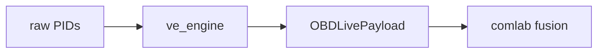

# Obsidian Markdown — the subset we use

Trimmed from the full Obsidian-Flavored Markdown reference to only what the vault
needs. Use these so links resolve and notes render the same way every time. For
anything not here, the full upstream reference is `Vault/ObsidianMDS.md`.

## Frontmatter

YAML at the very top of the file (see `frontmatter-schema.md` for our fields).
Lists may be `[a, b]` or block form. Links in frontmatter must be quoted:
`source: "labs/obdlab/docs/DLD_OBDLab.md"`.

## Wikilinks and embeds

```
[[OBDLab_KG_Wiki]]                     link to a note
[[OBDLab_KG_Wiki#Fuel trim|trim]]      link to a heading, custom text
[[code/core/ve_engine.py]]             link to a copied code file
![[DLD_OBDLab#Module Map]]             embed a section
![[modules.base#All modules]]          embed a Bases view
```

Prefer wikilinks over Markdown links inside the vault — they survive renames and
power the graph view. Use vault-relative paths matching the frontmatter so
`implements` / `drift_guards` targets are clickable.

## Callouts

Use sparingly, for things a reader must not miss:

```
> [!warning] Perception, not truth
> OBDLab output is the ECU's perception; gas chemistry is ground truth.

> [!note]- Provenance
> Copied from labs/obdlab/docs/ on build; do not edit here — edit the lab.
```

## Tables, math, mermaid

Standard GitHub tables. Inline math `$\lambda$`, block math in `$$ … $$`.
Mermaid for small diagrams:

````

````

## Conventions for vault notes

- **Vault wiki notes are read-only mirrors.** Add a callout reminding editors to
  change the lab, not the vault copy (the next build overwrites it).
- **One concept per note** where practical, so links and Bases rows are crisp.
- **Tag with the lab slug and lifecycle** (`#obdlab`, `#finished`) so views and
  the tag pane stay useful.
