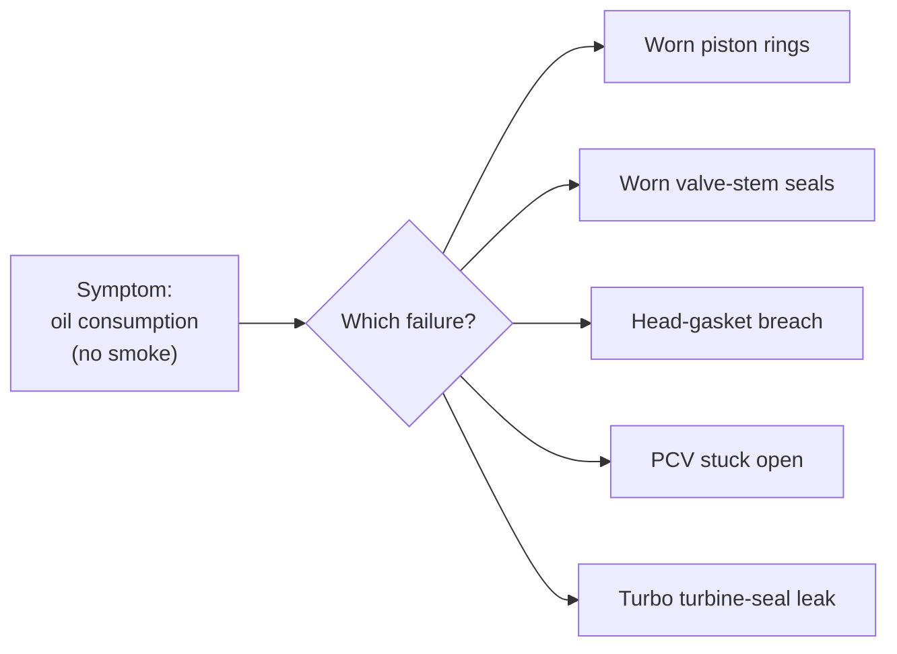
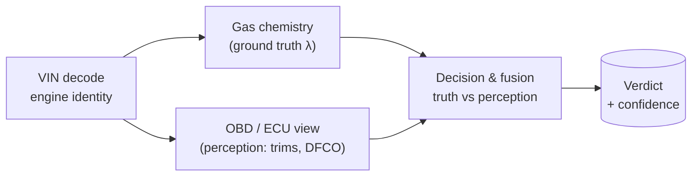
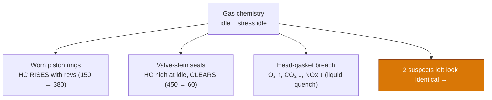
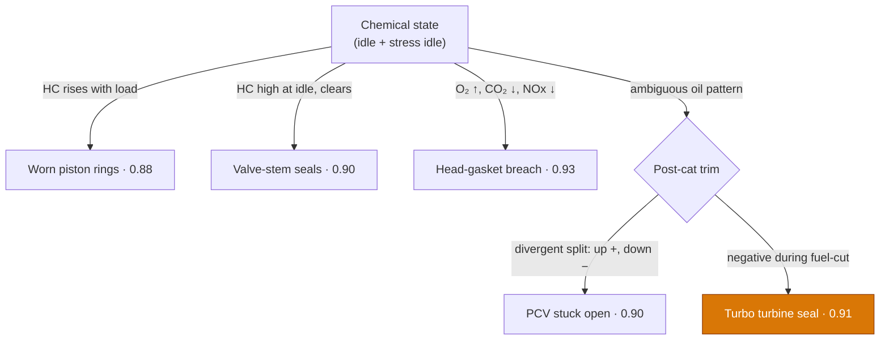

# Which of five failures is burning the oil?
### A behind-the-scenes diagnostic walkthrough — 11 slides

> Vehicle: Citroën 1.6-litre turbocharged direct-injection petrol, Euro 5.
> One slide per `---`. Every slide carries a flowchart, graph, or diagram.
> The culprit is revealed only when the evidence forces it.

---

## Slide 1 — The case

**One car. Five suspects. No visible smoke, no warning light.**

Oil disappears between services, yet the engine looks and runs perfectly. The job: from a
handful of tailpipe and sensor numbers, prove *which* of five mechanical faults is eating the oil.



> The symptom alone narrows the world to *these five* — and no further. Everything after this is deduction.

---

## Slide 2 — The hook: a problem that hides

Oil is leaving the engine and being burned or carried away **somewhere** — but the one clue a
human relies on, a blue haze under load, never shows. The car keeps its secret.

```
 oil level over distance (no warning light, no smoke seen)
 FULL ┤●
      │  ●
      │     ●
      │        ●          ← ~1 L gone per service interval
      │           ●
  LOW ┤              ●
      └───────────────────────────► km driven
        normal use · nothing visible at the tailpipe
```

> The most diagnostic symptom is **absent**. That forces the diagnosis off the eye and onto the sensors.

---

## Slide 3 — Behind the button: how the system reasons

Pressing *Run* doesn't trigger a guess. It runs a layered pipeline built on one idea —
**gas chemistry is ground truth; the engine's own sensors are only its perception** — and a final
stage that cross-checks the two.



> Gas chemistry does most of the sorting on its own. The ECU's perception is held back for the
> cases chemistry **cannot** separate — and the contradiction between the two is what cracks the hard ones.

---

## Slide 4 — Under the hood: glass box, not black box

Is it AI magic? **No — and that's the point.** The engine doesn't guess, and it isn't a single
value-vs-value lookup. It's a master technician's knowledge written down as explicit rules, plus a
scoring step that reads them — and shows its work.

```
 INBOUND (one car)          KNOWLEDGE (the atlas)           ENGINE (the logic)
 ─────────────────          ─────────────────────           ──────────────────
 evidence vector            each fault's fingerprint        1. GATE   does the required
   gas: HC, λ, O₂, NOx        as thresholds + weights            signature even fit?  (yes/no)
   obd: trims, DFCO   ──►    + what each fault means,   ──►  2. WEIGH  add up matching evidence
   dtc: history tags         related faults, fixes           3. COMPETE top score in group wins
                                                             4. ENRICH look up the winner's meaning
```

Three things lift it above a plain `if value > threshold`:

- **a pattern, not one number** — a verdict matches a whole gas + OBD + history fingerprint, each piece weighted;
- **it gates before it scores** — the chemistry must fit *at all* before anything is weighed (why the biggest number doesn't simply win);
- **it fuses truth vs perception** — it cross-checks the gas analyser's *real* λ against the ECU's *believed* λ and flags the contradiction; deterministic, yet more than any single sensor can do.

> Every verdict traces back to the exact readings that fired it. The intelligence is the **encoded
> expertise** — auditable and repeatable — not a hidden black box.

---

## Slide 5 — What the technician actually enters

No diagnosis is typed in — only measurements, in five steps. Each gas and OBD reading is taken at
**two operating points**: low idle (~700 rpm) and stress idle (~2,500 rpm).

```
 ┌─ STEP 1 ─ VIN ───────────► engine identity (turbo? sensors? Euro?)
 │
 ├─ STEP 2 ─ "oil consumption" ─► weak family-level clue only
 │
 ├─ STEP 3 ─ Gas analyser ───► CO · CO₂ · O₂ · HC · NOx · λ
 │            at LOW IDLE  ──┐
 │            at STRESS IDLE ┘ (two points = a behaviour, not a snapshot)
 │
 ├─ STEP 4 ─ OBD reader ────► fuel trims · temps · downstream sensor
 │            at LOW IDLE + STRESS IDLE
 │
 └─ STEP 5 ─ "Run diagnostic" ─► pipeline deduces the verdict
```

> Two points beat one: a fault is identified by **how its numbers move** between idle and stress
> idle, not by a single still frame.

---

## Slide 6 — Two sensors, two stories

The VIN reveals the decisive hardware: a wideband sensor **before** the catalyst and a narrowband
sensor **after** it, the latter running a secondary fuel-trim loop. This is what makes burned oil
visible even when combustion is clean.

```
   AIR ─►[ ENGINE ]─►  (S1)  ─►[ CATALYST ]─►  (S2)  ─► tailpipe
                     wideband                narrowband
                "how it BURNS"            "what's in the PIPE"
                                          + secondary fuel trim

   oil in exhaust → O₂ consumed at S2 → S2 reads FALSE-RICH
        → ECU pulls fuel → NEGATIVE post-cat trim
        …while S1 can still read a perfect λ ≈ 1.00
```

> Upstream tells you how the engine burns. **Downstream tells you what ends up in the pipe.**
> The shape of that negative downstream trim is a per-fault fingerprint.

---

## Slide 7 — Round 1: gas chemistry eliminates three

Read at idle and stress idle, three suspects can't hold their story across the two points and fall
out on chemistry alone.



> Healthy reference: CO ≈ 0.10%, CO₂ ≈ 14.8%, HC < 50 ppm, λ ≈ 1.00. Three faults each bend that
> chemistry in a unique direction — solved. **Two remain, and they look like twins.**

---

## Slide 8 — The deadlock: identical twins, one looks innocent

The two survivors — **PCV stuck open** and **turbo turbine-seal leak** — produce the same gas
story: extreme HC at idle that washes out at stress idle. Worse, on the *combustion* view the
turbo case looks perfectly healthy.

```
 HC (ppm)   idle ███████   stress ██
 PCV   idle |█████████████████████ 610     stress |█████ 170
 Turbo idle |████████████████████████ 720  stress |████ 130
            └ same shape: high at idle, clears with flow ┘

 Combustion view (upstream)      PCV            Turbo
   lambda at idle                0.925 (rich)   1.000 (perfect)
   CO at idle                    1.90% (high)   0.07% (clean)
```

> Stop at the gas slip and you're flipping a coin. The turbo case even *passes* the combustion
> check. The clue that breaks the tie isn't how the engine burns — it's what happens with the fuel **off**.

---

## Slide 9 — The insight: capturing DFCO between the two idle points

Deceleration fuel cut-off (DFCO) is not a third measurement — it's the **overrun while the engine
falls from stress idle back to low idle**. Snap the throttle shut at ~2,500 rpm; as revs drop with
the throttle closed, the ECU cuts the injectors. That window is logged between the two standard points.

```
 rpm
 2500 ┤        ╭───╮               ← STRESS IDLE  (sample point 2)
      │       ╱     ╲   throttle released
      │      ╱       ╲___           ← DECEL OVERRUN = DFCO
  700 ┤─────╯           ╰─────────  ← LOW IDLE     (sample point 1)
      └──────────────────────────────► time
 inj :  ON         ON  [ OFF ]   ON      injectors cut during overrun
 B1S2:  ~0          ~0  −14% ⚠   −5%     downstream STILL pulling fuel
                         └─ with ZERO fuel injected, a rich reading
                            cannot come from combustion
```

> With the injectors off, any persistent rich downstream signal **cannot be fuel**. A deep negative
> trim here means hydrocarbons are entering *after* the cylinders. This single transition is the discriminator.

---

## Slide 10 — The reveal: the turbocharger turbine seal

The contradiction — flawless combustion, yet a rich exhaust during fuel-cut — points past the
engine into the turbo's hot exhaust housing. Oil escapes the **turbine-side seal** directly into
the exhaust, *after* combustion.

```
   [ ENGINE ]──► exhaust ──►  ((  TURBO  ))  ──►[ CAT ]──► (S2) ──► pipe
   burns clean              oil leaks past          sees "rich",
   λ ≈ 1.00                 turbine seal here ▲      trims −14% on fuel-cut
                            the culprit

   UPSTREAM  λ 1.000  ✔ healthy   ┐
   DOWNSTREAM −14% during DFCO ✖  ┘─► only one source fits: post-combustion oil
```

> **Verdict: turbocharger turbine-seal oil leak.** The engine looked innocent because the crime
> scene was downstream — and the decisive witness only spoke while the fuel was cut. Confidence ≈ 0.91.

---

## Slide 11 — Case closed: the whole deduction

Three suspects fall to chemistry; the final two split on the downstream trim — divergent at idle
for PCV, negative on fuel-cut for the turbo.



**The three ideas that solved it:** an absent symptom is still data; the engine that burns
perfectly can still be guilty; and the proof lives *downstream*, captured in the moment the fuel
goes off.
