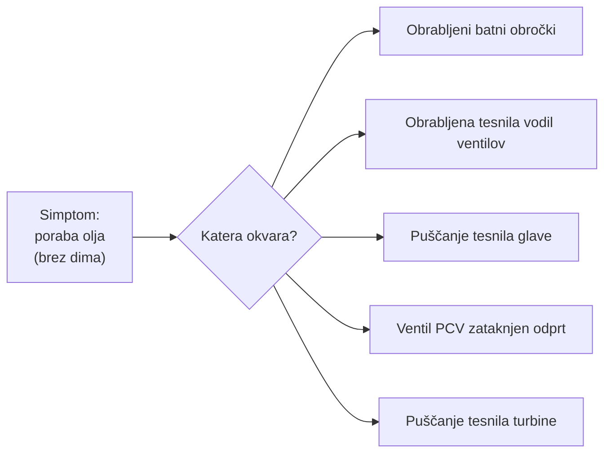
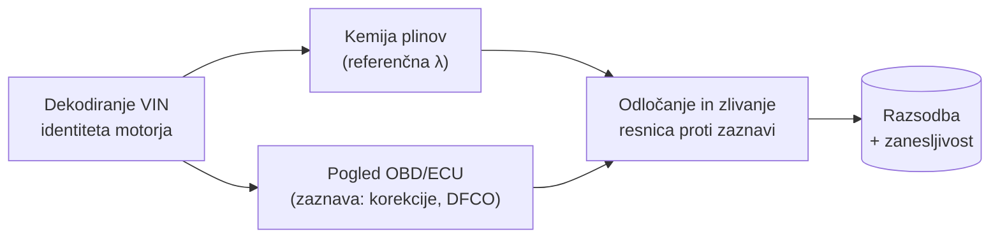
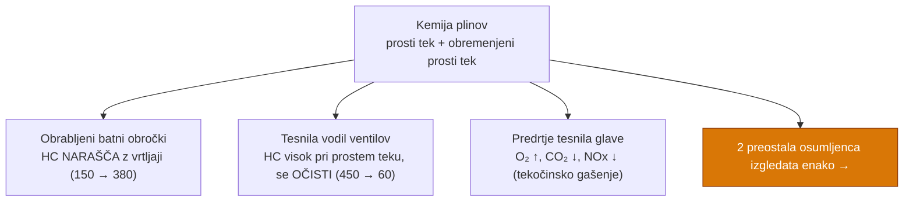
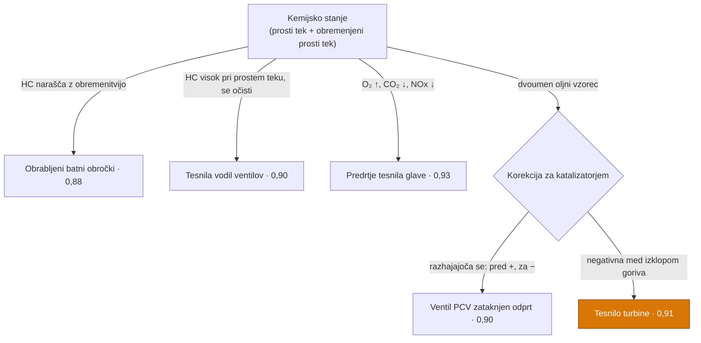

# Katera od petih okvar troši olje?
### Diagnostični sprehod za kulisami — 10 diapozitivov

> Vozilo: Citroën 1,6-litrski turbo bencinski motor z neposrednim vbrizgom, Euro 5.
> En diapozitiv na `---`. Vsak diapozitiv vsebuje diagram poteka, graf ali shemo.
> Krivec se razkrije šele, ko ga dokazi prisilijo na plano.

---

## Diapozitiv 1 — Primer

**En avtomobil. Pet osumljencev. Brez vidnega dima, brez opozorilne lučke.**

Olje izginja med servisi, motor pa izgleda in deluje brezhibno. Naloga: iz peščice številk z
izpušne cevi in senzorjev dokazati, *katera* od petih mehanskih okvar troši olje.



> Sam simptom zoži izbor na teh pet — in nič več. Vse, kar sledi, je sklepanje.

---

## Diapozitiv 2 — Past: težava, ki se skriva

Olje zapušča motor in nekje zgori ali se odnese — a edinega namiga, na katerega se zanese človek,
modrikastega dima pod obremenitvijo, ni nikjer. Avto skrije svojo skrivnost.

```
 raven olja glede na prevožene kilometre (brez lučke, brez vidnega dima)
 POLNO ┤●
       │  ●
       │     ●
       │        ●          ← ~1 L porabljen na servisni interval
       │           ●
 PRAZNO┤              ●
       └───────────────────────────► prevoženi km
         običajna vožnja · na izpušni cevi nič vidnega
```

> Najbolj diagnostični simptom manjka. To preusmeri diagnozo z očesa na senzorje.

---

## Diapozitiv 3 — Za gumbom: kako sistem sklepa

Pritisk na »Zaženi« ne sproži ugibanja. Sproži večplastni cevovod, zgrajen na eni zamisli —
**kemija izpušnih plinov je referenčna resnica; senzorji motorja so le njegova zaznava** — ter
zaključno stopnjo, ki oboje navzkrižno preveri.



> Kemija plinov sama opravi večino razvrščanja. Zaznava ECU se prihrani za primere, ki jih kemija
> ne more ločiti — in prav protislovje med njima razvozla najtežje.

---

## Diapozitiv 4 — Kaj tehnik dejansko vnese

Diagnoza se ne vnaša — le meritve, v petih korakih. Vsaka meritev plinov in OBD se opravi pri
**dveh obratovalnih točkah**: nizki prosti tek (~700 vrt/min) in obremenjeni prosti tek (~2.500 vrt/min).

```
 ┌─ KORAK 1 ─ VIN ──────────► identiteta motorja (turbo? sonde? Euro?)
 │
 ├─ KORAK 2 ─ »poraba olja« ─► le šibek namig na ravni družine
 │
 ├─ KORAK 3 ─ Analizator plinov ─► CO · CO₂ · O₂ · HC · NOx · λ
 │            pri NIZKEM PROSTEM TEKU  ──┐
 │            pri OBREMENJENEM PROSTEM TEKU ┘ (dve točki = vedenje, ne posnetek)
 │
 ├─ KORAK 4 ─ OBD bralnik ───► korekcije vbrizga · temperature · sonda za kat.
 │            pri NIZKEM + OBREMENJENEM PROSTEM TEKU
 │
 └─ KORAK 5 ─ »Zaženi diagnostiko« ─► cevovod izpelje razsodbo
```

> Dve točki sta boljši od ene: okvaro prepoznamo po tem, **kako se njene številke premaknejo** med
> prostim tekom in obremenjenim prostim tekom, ne po enem samem zamrznjenem posnetku.

---

## Diapozitiv 5 — Dve sondi, dve zgodbi

VIN razkrije odločilno strojno opremo: širokopasovno sondo **pred** katalizatorjem in ozkopasovno
sondo **za** njim, pri čemer slednja vodi sekundarno zanko korekcije vbrizga. Prav to naredi
zgorelo olje vidno, tudi ko je zgorevanje čisto.

```
   ZRAK ─►[ MOTOR ]─►  (S1)  ─►[ KATALIZATOR ]─►  (S2)  ─► izpušna cev
                     širokopasovna              ozkopasovna
                     "kako GORI"                "kaj je v CEVI"
                                                + sekundarna korekcija vbrizga

   olje v izpuhu → O₂ porabljen pri S2 → S2 kaže LAŽNO BOGATO
        → ECU odvzame gorivo → NEGATIVNA korekcija za katalizatorjem
        …medtem ko S1 še vedno lahko kaže popolno λ ≈ 1,00
```

> Sonda pred katalizatorjem pove, kako motor gori. **Sonda za njim pove, kaj konča v cevi.**
> Oblika te negativne korekcije za katalizatorjem je prstni odtis posamezne okvare.

---

## Diapozitiv 6 — 1. krog: kemija plinov izloči tri

Izmerjeni pri prostem teku in obremenjenem prostem teku trije osumljenci ne morejo ohraniti svoje
zgodbe med obema točkama in odpadejo že na kemiji.



> Zdrava referenca: CO ≈ 0,10 %, CO₂ ≈ 14,8 %, HC < 50 ppm, λ ≈ 1,00. Vsaka od treh okvar to kemijo
> upogne v svojo edinstveno smer — rešeno. **Dve ostaneta in izgledata kot dvojčka.**

---

## Diapozitiv 7 — Pat položaj: enaka dvojčka, eden izgleda nedolžen

Preživela osumljenca — **zataknjen ventil PCV** in **puščanje tesnila turbine** — ustvarita enako
plinsko zgodbo: izjemen HC pri prostem teku, ki se pri obremenjenem prostem teku spere. Še huje: na
pogledu zgorevanja primer turbine izgleda popolnoma zdrav.

```
 HC (ppm)   prosti tek ███████   obremenjeni ██
 PCV   p.t. |█████████████████████ 610     obrem. |█████ 170
 Turbo p.t. |████████████████████████ 720  obrem. |████ 130
            └ enaka oblika: visok pri prostem teku, se očisti s pretokom ┘

 Pogled zgorevanja (pred kat.)    PCV            Turbo
   lambda pri prostem teku        0,925 (bogato) 1,000 (popolno)
   CO pri prostem teku            1,90 % (visok) 0,07 % (čist)
```

> Če se ustaviš pri listku z analizo plinov, mečeš kovanec. Primer turbine celo *prestane*
> preverjanje zgorevanja. Namig, ki razveže vozel, ni v tem, kako motor gori — temveč v tem, kaj se
> zgodi, ko je gorivo **izklopljeno**.

---

## Diapozitiv 8 — Spoznanje: zajem DFCO med obema točkama prostega teka

Izklop goriva med zaviranjem z motorjem (DFCO) ni tretja meritev — je **faza popuščanja, ko motor
pade z obremenjenega prostega teka nazaj na nizki prosti tek**. Nenadoma zapri plin pri ~2.500
vrt/min; ko vrtljaji padajo ob zaprtem plinu, ECU izklopi vbrizgalnike. To okno se zabeleži med obema
standardnima točkama.

```
 vrt/min
 2500 ┤        ╭───╮               ← OBREMENJENI PROSTI TEK (točka 2)
      │       ╱     ╲   plin sproščen
      │      ╱       ╲___           ← FAZA POPUŠČANJA = DFCO
  700 ┤─────╯           ╰─────────  ← NIZKI PROSTI TEK (točka 1)
      └──────────────────────────────► čas
 vbr.:  VKL        VKL [ IZKL ]  VKL    vbrizgalniki izklopljeni med popuščanjem
 B1S2:  ~0          ~0  −14% ⚠   −5%    sonda za kat. ŠE VEDNO odvzema gorivo
                         └─ ob NIČ vbrizganega goriva bogata meritev
                            ne more izvirati iz zgorevanja
```

> Ko so vbrizgalniki izklopljeni, noben vztrajen bogat signal za katalizatorjem ne more biti gorivo.
> Globoka negativna korekcija tu pomeni, da ogljikovodiki vstopajo *za* valji. Prav ta prehod je razločevalnik.

---

## Diapozitiv 9 — Razkritje: tesnilo turbine turbopolnilnika

Protislovje — brezhibno zgorevanje, a bogat izpuh med izklopom goriva — kaže onkraj motorja, v
vroče izpušno ohišje turbine. Olje uhaja skozi **tesnilo na strani turbine** neposredno v izpuh,
*po* zgorevanju.

```
   [ MOTOR ]──► izpuh ──►  ((  TURBO  ))  ──►[ KAT. ]──► (S2) ──► cev
   gori čisto              olje uhaja mimo        vidi »bogato«,
   λ ≈ 1,00                tesnila turbine ▲      korigira −14 % ob izklopu goriva
                           krivec

   PRED KAT.  λ 1,000  ✔ zdravo    ┐
   ZA KAT.   −14 % med DFCO  ✖     ┘─► ustreza le en vir: olje po zgorevanju
```

> **Razsodba: puščanje olja skozi tesnilo turbine turbopolnilnika.** Motor je izgledal nedolžen,
> ker je bil kraj zločina za katalizatorjem — odločilna priča pa je spregovorila šele med izklopom
> goriva. Zanesljivost ≈ 0,91.

---

## Diapozitiv 10 — Primer zaključen: celotno sklepanje

Trije osumljenci padejo na kemiji; zadnja dva loči korekcija za katalizatorjem — pri PCV
razhajajoča se pri prostem teku, pri turbini negativna ob izklopu goriva.



**Tri zamisli, ki so rešile primer:** odsoten simptom je še vedno podatek; motor, ki gori
brezhibno, je lahko vseeno kriv; dokaz pa živi *za katalizatorjem*, zajet v trenutku, ko gorivo ugasne.
