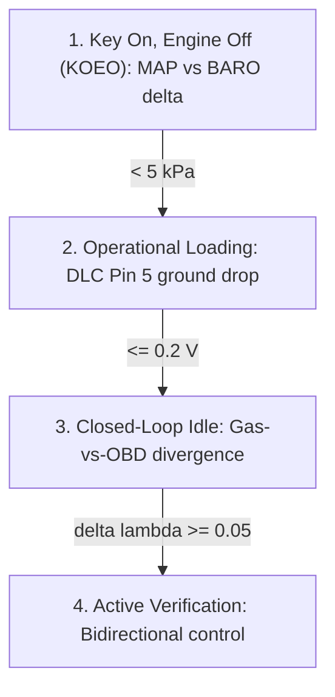
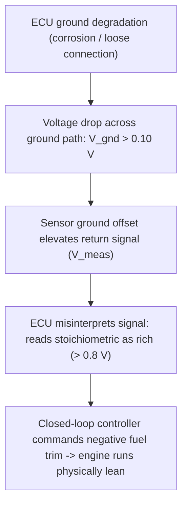

# Diagnostic Specification for Petrol Spark-Ignition Engines: Discriminating Control-System Faults from Physical Chemistry Deviations

## Evaluation and Ranking of Diagnostic Candidates

In petrol spark-ignition engines, isolating a control-system failure from physical chemical deviations represents a fundamental challenge for vehicle diagnostics. When a control module ground path degrades or an analog signal shifts, the engine control unit (ECU) misinterprets the sensor feedback, forcing the closed-loop controller to drive the physical air-fuel mixture into severe enrichment or lean-burn limits. To establish a robust diagnostic hierarchy, candidate signals must be critically evaluated and ranked based on their discriminating power and practical execution in the workshop environment.

### 1\. Gas-vs-OBD Divergence Metric

  - **Status:** Kept.
  - **Justification:** This metric is the primary mathematical discriminator for isolating control-system feedback faults from actual mechanical or chemical system failures. In a pure chemical fault (such as an unmetered vacuum leak or a clogged fuel injector), the physical tailpipe chemistry measured by an external analyzer directly mirrors the lean or rich commands reported by the OBD-II fuel trim parameters. However, when an electrical ground offset or sensor calibration bias infects the control circuit, the ECU responds to a false feedback signal. This forces the actual combustion chemistry to run in the exact opposite direction of the OBD commands. This metric is a highly reliable indicator of control-loop divergence.

### 2\. Live-PID Plausibility Cross-Checks

  - **Status:** Kept.
  - **Justification:** This pre-start check isolates electrical reference voltage (V\_ref) instability and sensor scaling drift before dynamic engine variables introduce diagnostic noise. Comparing Manifold Absolute Pressure (MAP, PID $0B) with Barometric Pressure (BARO, PID $33 or derived) under Key On, Engine Off (KOEO) conditions serves as a reliable rationality test. Because no physical vacuum exists in a non-running engine, the manifold and ambient atmospheric pressures must be equal. Any pressure delta indicates an electrical circuit fault, reference voltage degradation, or internal sensor strain-gauge failure.

### 3\. Control-Module Supply and Ground Voltages

  - **Status:** Kept.
  - **Justification:** Ground circuit degradation is the primary cause of shifted analog sensor signals, particularly for sensors operating on low-voltage scales (0 V to 1 V). Measuring the voltage drop across Data Link Connector (DLC) Pin 5 (Signal Ground) and Pin 4 (Chassis Ground) relative to the battery negative terminal under high electrical current draw isolates ground offsets. High resistance on these pins directly indicates a compromised ECU reference ground.

### 4\. Active Bidirectional Command-vs-Response Verification

  - **Status:** Replaced.
  - **Justification:** This active test replaces passive freeze-frame and Mode $06 correlation checks. Passive monitors capture only historic data or slow-updating self-test routines. Active bidirectional control (e.g., using a diagnostic scan tool to command ±25% injector volume changes or modulating the EVAP purge valve) forces a step-change in the combustion chamber. Watching the physical exhaust gas analyzer and upstream O2 sensor PIDs respond in real-time verifies loop integrity. If the physical gas chemistry changes but the OBD sensor remains static or reacts in reverse, the sensor or control circuit is proven to be biased.

### 5\. Short-Term and Long-Term Fuel Trim (STFT/LTFT) Dynamics and Limits

  - **Status:** Kept.
  - **Justification:** Fuel trims represent the ECU’s adaptive software correction limits. In petrol engines, trims railed at positive or negative limits (±25%) indicate that the closed-loop system has reached its maximum correction boundary. If these railed limits occur while the physical exhaust gas analyzer reads near-perfect stoichiometry (λ = 1.00 ± 0.02), it indicates a false feedback loop rather than a physical fuel delivery or mechanical leak.

## Physical Rationales and Electro-Chemical Governing Mechanisms

To understand how a control-system fault mimics and disperses into chemistry-based fault codes, one must analyze the physical electrical and chemical mechanisms at play.

### Sensor Ground Offset and Closed-Loop Divergence

Conventional narrowband zirconia oxygen sensors act as galvanic cells, generating a voltage output (V\_sensor) between 0.1 V (lean, excess oxygen) and 0.9 V (rich, low oxygen) based on the partial pressure differential of oxygen between the exhaust gas and atmospheric reference air. This sensor signal is read by the ECU relative to a reference signal ground.

If the ECU ground circuit experiences high resistance due to corrosion, loose bonding, or shared chassis return paths, a ground voltage drop (ΔV\_gnd) develops when high-current accessories (e.g., radiator fans, blower motors) are active. The voltage perceived by the ECU's analog-to-digital converter becomes:

V\_meas = V\_sensor + ΔV\_gnd

If ΔV\_gnd = +0.20 V, a true stoichiometric sensor voltage of 0.45 V is interpreted by the ECU as 0.65 V (a rich mixture). In response, the closed-loop PI controller commands a negative fuel trim to reduce injector pulse-width. The ECU continues trimming fuel until V\_meas returns to the targeted 0.45 V switch point. At this point, the physical sensor voltage is actually:

V\_sensor = 0.45 V - 0.20 V = 0.25 V

This 0.25 V output corresponds to a lean mixture. The engine now runs physically lean, causing high oxygen levels, low carbon monoxide, and elevated oxides of nitrogen (NOx) at the tailpipe. Yet, the OBD-II fuel trim PIDs report a large negative correction (e.g., LTFT = -20%), indicating that the controller believes it is correcting an air/fuel ratio that was too rich. This creates a measurable divergence between the physical exhaust chemistry and the OBD command data.

### Key On, Engine Off (KOEO) Pressure Plausibility

The silicon piezoresistive strain gauges within MAP and BARO sensors require a regulated +5.0 V reference voltage (V\_ref) supplied by the ECU's internal voltage regulator. The sensor output voltage is ratiometric to this reference. If the ECU's internal regulator drifts, or if high-resistance shorts in other shared V\_ref sensor circuits pull down the voltage, the sensor outputs scale incorrectly.

Under KOEO conditions, no physical air is moving through the intake manifold, and the intake pressure must equal the ambient atmospheric pressure:

P\_MAP = P\_BARO

Because the physical environment enforces this equality, any divergence between the two sensor values read via OBD-II live data must be electrical or computational. For example, if P\_MAP reads 95 kPa while P\_BARO reads 101 kPa at sea level, the resulting 6 kPa offset shifts the calculated engine load model once the engine starts, skewing the base fuel maps and inducing false trim corrections.

### Historical Context of Fuel Trim Evolution

Modern OBD-II percentage-based fuel trims evolved from older proprietary OBD-I strategies. In OBD-I systems (such as pre-1996 General Motors vehicles), fuel feedback was measured on an 8-bit scale ranging from 0 to 255. The "Integrator" represented the short-term fuel correction, and the "Block Learn" represented the long-term adaptive correction.

A value of 128 indicated a neutral fuel correction, meaning the engine was running at stoichiometry with zero learned adjustment. Values from 129 to 255 indicated that the ECU was adding fuel to compensate for a lean condition, while values from 0 to 127 indicated that fuel was being subtracted to correct a rich mixture.

Under the standardized OBD-II system, these parameters were converted to percentage-based metrics (STFT and LTFT) operating from -100% to +100%, where 0% represents the stoichiometric baseline. Values above +10% or below -10% indicate that the ECU is actively compensating for an underlying system imbalance.

### Manufacturer-Specific Diagnostic Logic

Automotive manufacturers implement highly specific diagnostic logic that can cause control-system faults to mimic chemical pathway deviations. On Toyota platforms, the ratiometric Air-Fuel (A/F) sensor operates on a nominal voltage baseline of 3.3 V. Under normal operating conditions, the sensor voltage fluctuates within a narrow band of approximately ±0.3 V.

During rapid acceleration, the voltage drops below 2.8 V (indicating enrichment), while during deceleration fuel-cut events, the voltage rises above 4.0 V (indicating a lean condition). These voltage dynamics are the exact opposite of a conventional 0-1 V zirconia O2 sensor, where higher voltages indicate rich mixtures.

If a conventional four-wire heated O2 sensor is mistakenly installed in place of an A/F sensor (which is physically possible due to similar thread pitches and offset connector tabs), the ECU misinterprets the sensor's voltage output. This causes the combined short-term and long-term fuel trims to exceed +50%, triggering false P0171 or P0174 lean codes.

Additionally, Toyota's diagnostic logic utilizes a one-trip code, P0125, which is titled "insufficient coolant temperature for closed-loop operation" but actually acts as an A/F sensor response monitor. If the A/F sensor fails to exhibit sufficient voltage activity within a 90-second monitoring window under specific driving conditions (at least 1500 RPM and a vehicle speed of 25 to 62 mph after 140 seconds of runtime), the ECU stores P0125. This indicates that an electrical or heater circuit fault is mimicking a thermostat or coolant system failure.

On Chrysler platforms, a unique engine-off diagnostic routine is used to test oxygen sensor heaters. After the engine runs for at least five minutes and is shut down, the PCM measures the bias voltage applied to each O2 sensor. Because the internal resistance of the zirconia sensor decreases as it cools, the bias voltage is pulled to ground.

Once the bias voltage drops near 0 V, the PCM energizes the Auto Shutdown (ASD) relay to activate the heaters. If the heaters are functioning, the sensor's temperature and internal resistance increase, causing the bias voltage to rise. If the battery voltage drops below 10 V during this test, the routine is aborted. An electrical ground offset or high-resistance harness connection can disrupt this bias voltage decay, causing the PCM to store false heater circuit codes.

Under SAE J1979 Mode $06 guidelines, Siemens 655 KWP engine management systems (such as those used on 2.7L platforms) run highly specific diagnostic monitors. The catalyst efficiency monitor (TID $81, CID $01) tracks the deactivation of the catalytic converter by measuring the switching frequency of the downstream O2 sensor relative to the upstream sensor. If the downstream sensor switches more than 30% as often as the upstream sensor (a ratio \> 0.3) over a 48-switch cycle, a catalyst efficiency fault (P0420) is stored.

Similarly, the upstream sensor response monitors (TID $82, CID $03 and CID $06) evaluate the average rich-to-lean and lean-to-rich transition times over a 47-switch cycle. A critical component of this feedback loop is the P-jump delay.

If the transition times differ significantly, the lambda controller adjusts the P-jump delay to compensate for the sensor’s response bias. If the required adaptation time reaches a threshold of 849 ms, the system stores an O2 sensor response fault (P0133 or P0153). On a healthy vehicle, this transition time remains below 150 ms.

## Acquisition Protocols and Pre-Gate Criteria

To isolate control-module electrical offsets from physical combustion deviations in a workshop, the following multi-phase diagnostic protocol must be executed.

### Phase 1: Pre-Start Electrical and Pressure Gate

1.  Ensure the vehicle is parked on a level surface, set the transmission to Park, and engage the parking brake.
2.  Connect a battery maintainer to ensure a stable system voltage. Turn the ignition key on, but do not start the engine (KOEO).
3.  Connect a diagnostic scan tool to the J1962 DLC.
4.  Read the following initial parameters:
      - Engine Speed (PID $0C): Confirm it reads 0 RPM.
      - Control Module Voltage (PID $42): Confirm it reads ≥ 12.0 V (ideal rest range: 12.4 V to 12.8 V).
      - Manifold Absolute Pressure (PID $0B).
      - Barometric Pressure (PID $33 or derived BARO parameter).
5.  **Pre-Gate Evaluation:** If the absolute difference |P\_MAP - P\_BARO| ≥ 5 kPa, or if the 5 V sensor reference voltage measured at the MAP harness connector is outside the range of 4.5 V to 5.0 V, abort the testing protocol. The vehicle has failed the initial pre-gates, indicating a static sensor scaling bias or reference voltage circuit issue rather than a dynamic fuel-loop fault.

### Phase 2: Ground-Circuit Power Stress Test

Because ground offsets are current-dependent, the physical ground circuits must be tested under electrical load. This is designed to identify "pin walk" (where pins back out of connector housings due to vibration) or high resistance in ground paths:

1.  Connect a digital multimeter (DMM) set to the millivolt DC scale.
2.  Back-probe DLC Pin 5 (Signal Ground) with the positive DMM lead. Connect the negative lead directly to the negative battery terminal.
3.  Back-probe DLC Pin 4 (Chassis Ground) with a second DMM or switch the positive probe.
4.  To stress-test the ground paths, connect a DLC analyzer tool that draws a nominal 2 Amp current across Pins 4, 5, and 16. Alternatively, connect a 2-Ohm, 25-Watt power resistor in parallel to simulate peak diagnostic load.
5.  Turn on all high-draw vehicle electrical accessories (cabin blower motor on high, high-beam headlights, and rear glass window defroster).
6.  Crank and start the engine while monitoring the DMM. Record the maximum voltage drop observed during cranking and subsequent idle.

### Phase 3: Closed-Loop Combustion Mapping

1.  Ensure all electrical accessories are turned off.
2.  Run the engine until the Engine Coolant Temperature (ECT, PID $05) exceeds 80°C (176°F) to ensure complete transition into closed-loop operation.
3.  Allow the engine to settle at its warm curb idle speed (700 RPM to 850 RPM) for two minutes.
4.  Insert the sample probe of a calibrated 5-gas analyzer into the tailpipe.
5.  Establish a live data-logging session on the scan tool at a sampling rate of ≥ 10 Hz to record the following parameters over a 60-second window:
      - Short-Term Fuel Trim (STFT, PID $06).
      - Long-Term Fuel Trim (LTFT, PID $07).
      - Upstream Oxygen Sensor Voltage (PID $14 or equivalent wideband sensor current PID).
      - Tailpipe Exhaust Gases: Carbon Monoxide (CO), Carbon Dioxide (CO2), Hydrocarbons (HC), Oxygen (O2), and calculated tailpipe Lambda (λ\_tailpipe).

### Phase 4: Active Loop Stimulation

1.  Maintain the warm idle state.
2.  Access the scan tool’s active test or bidirectional override menu.
3.  Select "Injector Volume" or "Fuel Trim Override".
4.  Command a step-change of +25% fuel enrichment. Hold this command for 15 seconds.
5.  Record the response of the upstream O2 sensor voltage (or wideband pump current) and the tailpipe gas analyzer.
6.  Command a step-change of -12.5% fuel reduction. Hold this command for 15 seconds.
7.  Record the corresponding O2 sensor voltage and tailpipe gas analyzer response.

## Quantitative Diagnostic Signature Mapping

To isolate control-system faults from physical chemical pathway deviations, the following diagnostic boundaries must be applied.

<!-- TABLE: quantitative-signature-mapping -->
| Diagnostic Parameter | Test State / Maneuver | Expected Direction & Magnitude | Quantitative Threshold | Feasibility Tier | Source Basis |
|---|---|---|---|---|---|
| Gas-to-OBD Divergence (Δλ) | Warm engine idle (750 RPM) | Exhaust gas analyzer reads lean while OBD trims command rich (or vice-versa) | Δλ = \|λ_OBD − λ_tailpipe\| ≥ 0.05 | Tier B: 5-gas analyzer | Empirical-anecdotal |
| Adaptive Fuel Trim Limits | Dynamic cruise (1500–2500 RPM) | Trims flat-line at correction limits with un-correlated tailpipe chemistry | LTFT ≥ +25% or ≤ −25% | Tier A: Generic OBD-II | Manufacturer-typical |
| KOEO MAP-vs-BARO Correlation | KOEO (0 RPM), ignition ON | Static pressure split between manifold and ambient pressure | \|P_MAP − P_BARO\| ≥ 5 kPa | Tier A: Generic OBD-II | Manufacturer-typical |
| DLC Signal Ground drop | Idle under high electrical load | Voltage elevation on signal ground return circuit relative to battery negative | ΔV_gnd > 0.20 V | Tier C: DMM / breakout box | Standardized |
| Ground Path Voltage Drop | Idle under high electrical load | Voltage drop across specific chassis or engine grounds | ΔV > 0.10 V (ground joint) or > 0.20 V (wire/cable) | Tier C: DMM | Standardized |
| Active Overrides Response | Bidirectional fuel override at idle | Lack of O2 sensor swing or tailpipe change under commanded steps | O2 voltage delta < 0.1 V under +25% / −12.5% steps | Tier C: Bidirectional scan tool | Manufacturer-typical |
| Harness Wire Resistance | Harness disconnected, static check | Resistance between ECU sensor pin and sensor connector pin | R > 2.0 Ω (faulty) or > 10.0 Ω (broken) | Tier C: DMM | Standardized |

### Conditions Under Which Signatures May Fail

The diagnostic signatures in this specification are highly reliable, but they can fail under specific operating conditions:

  - **Upstream Exhaust System Leaks:** If a physical exhaust leak exists upstream of the oxygen sensor, outside air is drawn into the exhaust pipe during the low-pressure phases between cylinder firing events. This excess oxygen is read by the sensor as a lean condition, causing the ECU to command positive fuel trims. In this scenario, both the tailpipe gas analyzer and the OBD trims will indicate a lean condition. This mimics a fuel-delivery failure or vacuum leak, rather than a control-system electrical offset.
  - **Severe Cylinder Misfires:** A misfiring cylinder cannot burn the air-fuel charge. This causes the cylinder to act as an air pump, pushing raw oxygen and unburned fuel into the exhaust stream. The upstream O2 sensor detects this excess oxygen and drops its voltage output, which the ECU interprets as a lean condition. This drives the fuel trims highly positive. In this state, the tailpipe gas analyzer reads high oxygen levels along with elevated hydrocarbons, which can skew the calculated tailpipe lambda and mimic a control-system or sensor bias fault.

## Tooling Feasibility Classification

To assist workshop managers in implementing this protocol, the required diagnostic equipment is categorized into four distinct feasibility tiers.

### Tier A: Generic OBD-II Live Data and Monitors

This tier utilizes standard diagnostic functions (Modes $01, $02, and $06) that are available on entry-level scan tools. It requires no physical disassembly or specialized shop equipment. Key parameters include fuel trims, engine speed, coolant temperature, and pressure sensor PIDs.

### Tier B: 5-Gas Exhaust Emission Analyzer

This tier utilizes a standard shop-grade 5-gas exhaust analyzer to measure tailpipe emissions (CO, CO2, HC, O2, and NOx). This tool is standard in emissions-repair facilities and is used to directly verify engine combustion chemistry independent of OBD-II sensor data.

### Tier C: Added Shop Equipment

This tier requires common diagnostic and electrical testing tools found in a professional workshop:

  - **Digital Multimeter (DMM):** Used to perform voltage-drop tests, check wiring harness continuity, and verify reference voltages.
  - **DLC Breakout Box or Health Checker:** Used to isolate and stress-test Data Link Connector circuits under load.
  - **Bidirectional Scan Tool:** Used to command active fuel overrides and override the closed-loop system.
  - **Hand-Held Vacuum Pump:** Used to test MAP sensor scaling under controlled pressure steps.

### Tier D: Laboratory-Only or Impractical Equipment

This tier includes highly specialized equipment that is impractical for a standard automotive repair shop. Examples include laboratory-grade gas chromatographs, chassis dynamometer laboratory benches, and multi-channel data acquisition systems used to measure raw micro-amp sensor pump currents directly at the physical sensor cell. These tools are flagged as impractical for standard diagnostic facilities.

## Narrative Synthesis and Bottom Line

Integrating the Gas-vs-OBD Divergence Metric (Δλ ≥ 0.05), measured using a Tier B 5-gas exhaust analyzer, with active Tier C bidirectional fuel override stimulation provides a highly effective method to isolate control-system faults from physical combustion deviations. While passive scan-tool diagnostics often misclassify electrical ground offsets as physical "system too lean" (P0171) or "system too rich" (P0175) chemistry faults, direct tailpipe chemistry verification bypasses sensor-level reporting biases.

Applying this dynamic testing protocol establishes clear diagnostic separability, preventing the unnecessary replacement of functional catalytic converters, fuel injectors, and oxygen sensors.

## Open Questions and Field Collection Protocol

Several data gaps exist in public automotive engineering literature regarding how control-system faults mimic chemistry pathway deviations:

  - **High-Speed Bus-Induced Ground Noise:** There is limited documented data on transient ground-plane voltage spikes caused by high-speed CAN-FD bus transitions. It is unclear if these micro-second voltage fluctuations induce noise in the ECU's internal analog-to-digital converter (ADC) sampling registers, triggering sporadic, false trim adaptations.
  - **Wideband Sensor Pumping-Current Vulnerabilities:** Most public studies focus on older 0-1 V narrowband zirconia oxygen sensors. The exact vulnerability of modern wideband dual-cell pumping-current (Ip) oxygen sensors to signal ground resistance is less documented, particularly regarding how high-frequency alternator diode AC ripple current interferes with the pump cell driver circuit.

### Proposed Field Data Collection Plan

1.  Select cohort of 10 identical petrol vehicles with stable stoichiometric baselines (lambda = 1.00 +/- 0.02).
2.  Splice a high-precision, variable decade resistance box into the sensor ground return wire of the upstream O2 sensor.
3.  Step resistance from 0.1 Ohm to 50.0 Ohms under three states:
      - Engine Idle (750 RPM)
      - Part-Throttle (2500 RPM)
      - Maximum Electrical Accessory Load
4.  Record and plot:
      - STFT/LTFT Response Curves
      - Physical Exhaust Lambda (via tailpipe gas analyzer)
      - Transient Voltage Drop on DLC Pin 5
5.  Establish the precise resistance threshold where trim shift diverges from actual physical stoichiometry, creating a lookup table for workshop diagnostics.
