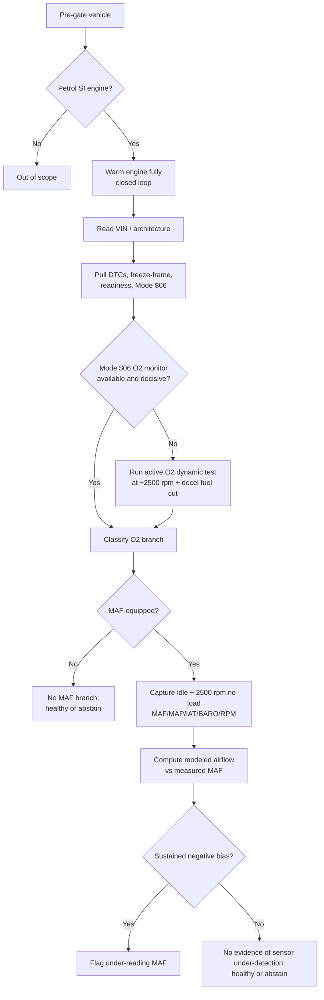
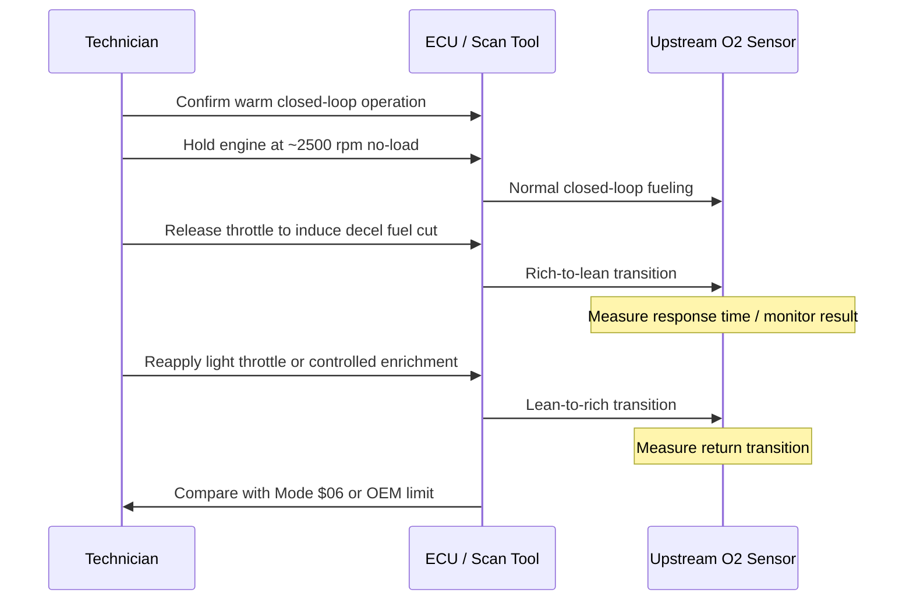

# Cluster 6 Sensor Under-Detection Research Report

## Executive Summary

The attached context document makes the core problem unusually clear: 4DLab is not blocked by missing rules so much as by missing distinguishers in the measurements it actually receives. In this cluster, the failure mode is specifically **under-detection**: a degraded oxygen sensor or an under-reading MAF can still look normal in a steady snapshot, so a healthy-looking static read is not strong evidence of a genuinely healthy vehicle. That framing is fully consistent with emissions-monitoring regulations, which explicitly require monitoring of **sensor activity, response rate, and related dynamic characteristics**, not just static values. fileciteturn0file0 citeturn72view0turn72view1

The strongest practical conclusion is that **there is no single universal scalar that separates the entire cluster across both lazy O2 sensors and under-reading MAF sensors**. The smallest practical combination is: **first, an ECU-side oxygen-sensor dynamics readout using Mode $06 when available, backed up by a forced rich↔lean response-time test when it is not; second, an architecture-gated MAF plausibility comparison between measured MAF and calculated airflow at fixed operating points**. That combination is materially better than any static PID or one-time gas snapshot, and it matches the context document’s warning that dynamic behavior, not static magnitude, is what separates hidden sensor faults from truly healthy vehicles. fileciteturn0file0 citeturn72view0turn72view2turn64view5turn47view0

For the **oxygen-sensor half** of the cluster, the best discriminator is the ECU’s own monitor result. California OBD rules require that recent monitor results and their minimum and maximum acceptable limits be available over the data link in SAE J1979 format, and they define oxygen-sensor deterioration in terms of output, amplitude, activity, and especially **response rate**, including delayed reaction and slow rich-to-lean or lean-to-rich transitions. That makes Mode $06 the highest-value first read because it uses vehicle-specific thresholds, ECU-native sampling, and already-standardized pass/fail bands. citeturn72view0turn72view2turn65view1turn65view2

For the **MAF half** of the cluster, the best practical discriminator is not another oxygen-sensor test, but a plausibility check against modeled engine airflow. MAF sensors are designed to measure mass airflow directly and quickly; Bosch’s HFM 2 documentation reports ±4% accuracy and a time constant of at most 20 ms for the sensor element, while DENSO and professional service literature emphasize that contamination or characteristic drift can still leave a sensor functioning while biasing its output enough to cause drivability and load-estimation errors. A plausibility comparison against MAP/RPM/IAT/BARO-derived airflow at warm idle and 2500 rpm no-load is therefore the most defensible workshop-level screen for under-reading MAFs. citeturn45view5turn45view2turn45view0turn47view0

Two further findings matter for protocol design. First, **idle cross-counts should not be the primary discriminator**: they are directionally useful, but too dependent on sensor type, ECU strategy, and scan-tool sampling to serve as a fleet-wide threshold. Second, **heater behavior is secondary rather than primary**: it is useful for cold-start and gross heater-fault detection, but it is not the best way to expose a hot, lazy sensor that appears normal once fully warmed up. Both points confirm the context document’s broader principle that a single channel should not claim certainty when the physics of the measurement does not warrant it. fileciteturn0file0 citeturn49view1turn72view1turn50view1

## Background Context and Verbatim Question Inventory

The background file describes 4DLab as a **rule-based petrol-engine fault-diagnosis engine** whose current single-verdict accuracy is limited mainly by **measurement discrimination**, not by missing software logic. Its emitter modules send downstream signals such as a reduced GASLab chemical-state label, OBD live PID data, DTCs and Mode $06 monitor results, and VIN/symptom context, but they do not themselves emit verdicts. The system’s dominant real-world limitation is that many vehicles arrive with only **a warm-idle 5-gas snapshot and sparse diagnostics**, which leaves several confusable fault families physically inseparable. The document also states an existing equipment baseline of a **5-gas analyzer** plus a **generic OBD-II scan tool with Mode $01/$02/$03/$06 capability**, and it explicitly frames this research as the search for **incremental, practically-acquirable measurements** that restore separability. fileciteturn0file0

Three context points are especially load-bearing for this cluster. First, the system already recognizes that **a single static reading often cannot separate confusable families**, which directly matches the “lazy/biased sensor read as healthy” problem. Second, the context proposes that some hard collisions separate on an **RPM-step or dual-point reading**, which is relevant here for MAF plausibility checks but less decisive for O2-sensor dynamics than ECU-side or scope-based timing. Third, 4DLab’s architecture requires **honest abstention** when the measure simply does not carry the needed information; that principle remains appropriate here whenever only static data are available. fileciteturn0file0

The second file defines Cluster 6 as the problem of separating a **degraded sensor** from a **genuinely healthy vehicle**, with emphasis on lazy or biased O2 sensors and under-reading MAF sensors that still produce normal-looking steady values. It also explicitly asks that each candidate signal be kept, replaced, or rejected, and it requires quantitative thresholds to be classified as **standardized**, **manufacturer-typical**, or **empirical-anecdotal**. fileciteturn0file1

The six specific research questions, reproduced verbatim from the second file, are: fileciteturn0file1

1. **Discriminating measurement** — the single measurement, or smallest combination, that most reliably separates this cluster. Rank candidates by discriminating power × practicality.
2. **Physical rationale** — the combustion / sensor / measurement mechanism that makes it separate.
3. **Acquisition protocol** — exact procedure and equipment: test maneuver, RPM/load points, engine/warm-up state, sampling, number of points, and any architecture pre-gate required.
4. **Expected signature** — the quantitative separator: direction, approximate magnitude, and a usable threshold or decision band, with numeric ranges where the literature supports them. State uncertainty and the conditions under which it fails.
5. **Feasibility tier** — classify the equipment as (a) generic OBD-II live data / Mode $06, (b) the existing 5-gas analyzer used differently (e.g. transient or two-point capture, second probe), (c) added shop equipment (pressure transducer, scope, leak/compression tester), or (d) lab-only / impractical. Flag anything not obtainable in a normal workshop.
6. **Evidence** — cite authoritative sources and note each source's reliability.

Key assumptions and unresolved details in the supplied files are also worth surfacing. The brief does **not** specify whether the O2 sensor under study is narrowband or wideband on a given vehicle, whether the vehicle is MAF-equipped or speed-density, what sampling rates are available on the scan tool, or what engine-size metadata are guaranteed at test time. Those are not minor omissions: they change whether cross-counts are meaningful, whether MAF plausibility is even applicable, and whether generic live data can resolve millisecond-level behavior well enough to avoid a scope. fileciteturn0file0 fileciteturn0file1

## Research Framing and Prioritized Source Sets

### Question One

To answer the discriminating-measurement question rigorously, external information is needed in four categories: OBD monitor design and legal requirements; oxygen-sensor dynamic fault definitions; MAF sensor operating physics and response characteristics; and workshop-level rationality strategies that compare MAF, MAP, RPM, and trims. The major assumption is that “single measurement” may not be technically achievable across both O2 and MAF subcases; if so, the correct answer is a **smallest combination** plus abstention when one branch is not available. fileciteturn0file1 citeturn72view0turn72view2turn45view5turn47view0

| Priority | URL | Type | Date | One-sentence rationale | Ref |
|---|---|---|---|---|---|
| High | `https://www.arb.ca.gov/regact/2015/obdii2015/finalregorder2.pdf` | Primary regulation | 2015 | Defines what OBD II must detect for oxygen and exhaust-gas sensors, including response-rate deterioration and standardized reporting of monitor results and limits. | citeturn72view0turn72view1turn72view2 |
| High | `https://www.farnell.com/datasheets/69647.pdf` | OEM component datasheet | undated public PDF | Gives Bosch HFM 2 MAF sensor accuracy and time-constant data that anchor what a healthy MAF is physically expected to do. | citeturn45view5 |
| High | `https://www.denso-am.eu/products/engine-management-systems/mass-air-flow-sensors#textContent-33196` | OEM technical page | current site content | Explains how MAF output is converted for ECU use and how contamination or damage alters sensor characteristics without necessarily causing total failure. | citeturn45view0turn45view2 |
| Medium | `https://gearsmagazine.com/magazine/a-breath-of-fresh-air-8-pin-mass-airflow-sensors/` | Professional service literature | 2018-02-28 | Gives practical MAF rationality logic used in the field, including comparison of MAP and MAF against load and speed. | citeturn47view0 |
| Medium | `https://en.wikipedia.org/wiki/On-board_diagnostics` | Secondary standards summary | current page crawl | Summarizes which OBD services expose oxygen-sensor monitoring and non-continuous monitor results. | citeturn27search0 |

### Question Two

The physical-rationale question requires primary sources on what OBD regulations mean by oxygen-sensor “response rate,” how narrowband and wideband sensors differ, and how MAF mismeasurement can be masked in closed loop. The main assumption is that the relevant mechanism is **dynamic concealment**: the ECU can compensate for static bias enough to make the vehicle look normal unless the measurement perturbs the system or compares two different sensing pathways. fileciteturn0file1 citeturn72view0turn72view1turn45view2turn50view1

| Priority | URL | Type | Date | One-sentence rationale | Ref |
|---|---|---|---|---|---|
| High | `https://www.arb.ca.gov/regact/2015/obdii2015/finalregorder2.pdf` | Primary regulation | 2015 | Explicitly defines response-rate deterioration for O2 sensors, including delayed initial response and slow rich↔lean transitions. | citeturn72view0 |
| High | `https://www.bosch.com/stories/the-history-of-the-bosch-lambda-sensor/` | OEM historical/technical background | 2016 article, current page | Explains why lambda sensing exists, how switching and wideband sensors differ, and why faster response matters. | citeturn50view1 |
| High | `https://www.denso-am.eu/products/engine-management-systems/mass-air-flow-sensors#textContent-33196` | OEM technical page | current site content | Describes how MAF and intake-air-temperature signals become the ECU’s estimate of intake air charge, which is the core plausibility mechanism. | citeturn45view2 |
| Medium | `https://en.wikipedia.org/wiki/Oxygen_sensor` | Secondary technical summary | current page crawl | Useful for the cross-count concept and for the point that aged sensors mainly degrade by slower response rather than obviously bad static output. | citeturn49view1turn49view2 |
| Medium | `https://gearsmagazine.com/magazine/a-breath-of-fresh-air-8-pin-mass-airflow-sensors/` | Professional service literature | 2018-02-28 | Shows how ECM rationality checks exploit disagreement between MAF, MAP, APP, and RPM instead of trusting one sensor in isolation. | citeturn47view0 |

### Question Three

The protocol question needs sources that support what must be measured, which maneuvers are recognized by regulations or practice, and what monitor outputs are standardized. An important assumption is that the protocol should be **tiered**: first use existing OBD capabilities, then escalate to a scope only when generic live data cannot resolve the needed dynamics. fileciteturn0file1 citeturn72view0turn72view2turn27search0

| Priority | URL | Type | Date | One-sentence rationale | Ref |
|---|---|---|---|---|---|
| High | `https://www.arb.ca.gov/regact/2015/obdii2015/finalregorder2.pdf` | Primary regulation | 2015 | It gives the monitor categories, response-rate requirements, and J1979 reporting requirements that the protocol should exploit instead of duplicating blindly. | citeturn72view0turn72view2 |
| High | `https://en.wikipedia.org/wiki/On-board_diagnostics` | Secondary standards summary | current page crawl | Summarizes that Mode $05/$06 carry oxygen-sensor monitor results and non-continuous monitor test values. | citeturn27search0 |
| High | `https://gearsmagazine.com/magazine/a-breath-of-fresh-air-8-pin-mass-airflow-sensors/` | Professional service literature | 2018-02-28 | Supports the use of fixed operating points and cross-sensor rationality logic in workshop procedure. | citeturn47view0 |
| Medium | `https://www.farnell.com/datasheets/69647.pdf` | OEM component datasheet | undated public PDF | The 20 ms time constant is a strong cue that exact dynamic fallback testing needs instrumentation better than slow live-PID polling. | citeturn45view5 |

### Question Four

The expected-signature question requires the closest thing available to quantitative thresholds: standardized transport fields, vehicle-specific pass/fail bands, component-level timing data, and any widely repeated workshop bands that can be clearly labeled as non-standardized. The biggest assumption here is unavoidable: public, fleet-wide numeric thresholds for lazy O2 response and MAF plausibility are **sparse**, so some decision bands must be marked as vehicle-specific or empirical rather than standardized. fileciteturn0file1 citeturn72view0turn72view2turn45view5turn49view1

| Priority | URL | Type | Date | One-sentence rationale | Ref |
|---|---|---|---|---|---|
| High | `https://www.arb.ca.gov/regact/2015/obdii2015/finalregorder2.pdf` | Primary regulation | 2015 | Best source for what counts as oxygen-sensor deterioration and for the rule that recent monitor values and limits must be exposed via J1979. | citeturn72view0turn72view2 |
| High | `https://en.wikipedia.org/wiki/On-board_diagnostics` | Secondary standards summary | current page crawl | Useful specifically because it lists that Mode $05/$06 oxygen-sensor monitoring includes switch-time and transition metrics in milliseconds. | citeturn27search0 |
| High | `https://www.farnell.com/datasheets/69647.pdf` | OEM component datasheet | undated public PDF | Gives a concrete MAF timing and accuracy baseline from a known OEM sensor family. | citeturn45view5 |
| Medium | `https://en.wikipedia.org/wiki/Oxygen_sensor` | Secondary technical summary | current page crawl | Supports the non-numeric but important relation between slower response and lower cross-count activity. | citeturn49view1turn49view2 |
| Medium | `https://www.denso-am.eu/products/engine-management-systems/mass-air-flow-sensors#textContent-33196` | OEM technical page | current site content | Supports the expectation that contamination changes MAF characteristics and therefore plausibility versus modeled airflow. | citeturn45view0turn45view2 |

### Question Five

The feasibility-tier question is mainly a matter of mapping the candidate measurements onto the baseline equipment from the context document and checking whether each measurement depends on ECU-native monitor access, a scope, or lab-grade equipment. The key assumption is that “practical” means **normal workshop availability**, not emissions-lab traceability. fileciteturn0file0 fileciteturn0file1 citeturn72view2turn45view5

| Priority | URL | Type | Date | One-sentence rationale | Ref |
|---|---|---|---|---|---|
| High | `https://www.arb.ca.gov/regact/2015/obdii2015/finalregorder2.pdf` | Primary regulation | 2015 | Confirms which test results are available through the data link, which directly determines what can stay in Tier (a). | citeturn72view2 |
| High | `https://www.farnell.com/datasheets/69647.pdf` | OEM component datasheet | undated public PDF | Indicates the speed of the underlying MAF signal and therefore whether generic live data can realistically substitute for faster instrumentation. | citeturn45view5 |
| Medium | `https://gearsmagazine.com/magazine/a-breath-of-fresh-air-8-pin-mass-airflow-sensors/` | Professional service literature | 2018-02-28 | Useful for identifying what is conventional shop practice versus what already assumes more specialized tooling. | citeturn47view0 |
| Medium | `https://en.wikipedia.org/wiki/On-board_diagnostics` | Secondary standards summary | current page crawl | Confirms which OBD services are generic and therefore workshop-plausible. | citeturn27search0 |

### Question Six

The evidence question requires source-quality grading more than new technical facts. The main need is to distinguish legal/technical primary sources from OEM component literature and from trade or secondary summaries, so that thresholds are not overstated. The important assumption is that public access to the full paid SAE/ISO texts is limited, so CARB’s incorporation of J1979 requirements and public OEM material become the practical primary basis. fileciteturn0file1 citeturn72view2turn45view5turn45view2

| Priority | URL | Type | Date | One-sentence rationale | Ref |
|---|---|---|---|---|---|
| High | `https://www.arb.ca.gov/regact/2015/obdii2015/finalregorder2.pdf` | Primary regulatory source | 2015 | Highest reliability for legal monitor requirements, standardized reporting, and oxygen-sensor fault definitions. | citeturn72view0turn72view1turn72view2 |
| High | `https://www.farnell.com/datasheets/69647.pdf` | OEM component datasheet | undated public PDF | High reliability for Bosch HFM sensor physics, rated accuracy, and time constant. | citeturn45view5 |
| High | `https://www.denso-am.eu/products/engine-management-systems/mass-air-flow-sensors#textContent-33196` | OEM technical page | current site content | High-to-moderate reliability for MAF construction, ECU interaction, and contamination effects. | citeturn45view0turn45view2 |
| Medium | `https://gearsmagazine.com/magazine/a-breath-of-fresh-air-8-pin-mass-airflow-sensors/` | Professional trade source | 2018-02-28 | Moderate reliability for real-world diagnostic logic; useful, but not a standards source. | citeturn47view0 |
| Medium | `https://en.wikipedia.org/wiki/On-board_diagnostics` | Secondary summary | current page crawl | Moderate-to-low reliability; acceptable for public-service/mode summaries, not for threshold-setting. | citeturn27search0 |

## Cross-Referenced Findings and Detailed Answers

The web findings largely **confirm** the provided context rather than contradict it. The context says a single static measurement misses under-detected sensor faults; CARB’s OBD text likewise defines oxygen-sensor deterioration in terms of **activity and response rate**, not just static output. The context assumes generic OBD and Mode $06 are part of the current baseline; CARB additionally requires recent monitor results and their limits to be available over the data link in J1979 format for covered monitors. The only meaningful tension is that the context’s general “two-point RPM-step” idea is not, by itself, sufficient for this cluster: for O2 under-detection, **sensor dynamics** are stronger than exhaust-only or steady-RPM delta logic. fileciteturn0file0 citeturn72view0turn72view2

### Question One Answer

The smallest practical combination that reliably separates this cluster is:

1. **Mode $06 oxygen-sensor monitor result, with a forced rich↔lean timing fallback** — **kept**.  
   This is the best discriminator for lazy or biased O2 sensors because it targets the exact failure mode the regulations care about: degraded response/activity, often with vehicle-specific pass/fail limits already computed by the ECU. When Mode $06 is unavailable, incomplete, or borderline, use an induced-response timing test as the active fallback. citeturn72view0turn72view2turn27search0

2. **MAF actual vs calculated airflow at warm idle and 2500 rpm no-load** — **kept**.  
   This is the best practical discriminator for under-reading MAF sensors because it compares one sensing pathway with another rather than trusting a single apparently normal value. It is especially strong when sustained negative MAF bias persists across both stabilized points. citeturn45view5turn45view2turn47view0turn64view5

3. **Sensor heater behavior and warm-up performance** — **kept, but demoted**.  
   Heater checks are useful for cold-start and gross heater faults, and regulations explicitly require heater monitoring for heated exhaust-gas sensors, but heater behavior alone is not the best separator for a fully warm lazy sensor that still looks normal at steady state. citeturn72view1turn50view1

4. **O2 switch rate / cross-counts at idle** — **replaced** as a primary screen.  
   Cross-counts do correlate with response quality, but they are weak as a fleet-wide decision rule because they depend on sensor architecture, ECU strategy, and data-capture rate. They can remain as a coarse secondary heuristic, not the lead discriminator. citeturn49view1turn50view1

5. **A single static O2 voltage, AFR, or MAF value** — **rejected**.  
   The cluster definition itself says the failure is under-detection by a normal-looking steady read, and the regulatory logic agrees that this class requires dynamic or monitor-based evidence. fileciteturn0file1 citeturn72view0turn72view1

If forced to choose **one additional measurement** to add first, I would choose **ECU-side oxygen-sensor monitor data from Mode $06, with an active response-time fallback**. If the goal is to cover the **entire** cluster, however, that one measurement is not enough; the MAF branch still needs a plausibility test. **Confidence: medium-high. Remaining uncertainty:** public sources expose the monitor framework clearly, but public fleet-wide numeric limits remain sparse and mostly vehicle-specific. citeturn72view0turn72view2turn47view0

### Question Two Answer

This cluster separates on **dynamic inconsistency**, not on static magnitude. A lazy narrowband O2 sensor can still settle to a plausible rich or lean voltage after enough time, and a biased or under-reading MAF can still be partially masked by closed-loop trim correction. In both cases, the ECU may keep the engine looking stable in steady state even though the sensor itself is degraded. That is why regulations and good diagnostic strategy focus on **response rate**, **activity**, **monitor sufficiency**, and **cross-sensor rationality** rather than a single held value. citeturn72view0turn72view1turn45view2

For oxygen sensors specifically, CARB defines response-rate faults broadly enough to include both **delayed initial reaction** and **slow rich-to-lean or lean-to-rich transitions**. It even specifies that, where a full sufficiency criterion is not technically feasible, the system must at minimum detect a **slow rich-to-lean response during fuel shut-off**, beginning from a rich condition around 0.7 V. That means the basic mechanism is not mysterious: the healthy sensor changes state fast enough for fuel control and monitoring, while the degraded one does not. citeturn72view0

For MAF sensors, the mechanism is different. The sensor is meant to provide the ECU’s load estimate directly; Bosch’s HFM data show that a healthy sensor is both fast and reasonably accurate, and DENSO notes that contamination can alter characteristics without completely disabling the sensor. A bad MAF therefore reveals itself best when its output is checked against **another path to air estimate**—typically MAP, RPM, IAT, BARO, and known engine displacement/volumetric behavior—rather than when it is read alone. citeturn45view5turn45view2turn45view0

So the physics and control logic both support the same answer: **use ECU-native dynamic monitor outputs for O2, and use rationality/plausibility against a modeled air path for MAF**. **Confidence: high. Remaining uncertainty:** wideband implementations and manufacturer-specific monitor calibrations vary, so exact numerical mapping differs by platform. citeturn50view1turn72view0turn64view5

### Question Three Answer

The acquisition protocol should be **branched and architecture-gated**, because one branch is for O2 dynamics and the other is for MAF plausibility.

For both branches, the common pre-gate is: petrol spark-ignition engine, no obvious upstream exhaust leak or intake tract disconnection, battery voltage stable, engine fully warmed, closed loop confirmed, and readiness/Mode $06 data captured **before** any code clearing. Vehicle identity should establish whether the upstream exhaust sensor is switching or wideband, and whether the engine is **MAF-equipped** or speed-density. If there is no MAF, the MAF branch is not applicable; if the upstream sensor is wideband, cross-count logic is not applicable. fileciteturn0file0 citeturn72view1turn47view0turn50view1

For the **O2 branch**, the first step is passive: retrieve OBD monitor data, especially Mode $06 oxygen-sensor monitor values and limits where available, alongside freeze-frame and readiness. If Mode $06 is absent, incomplete, or too close to the limit to be decisive, run an active dynamic test. The practical fallback is: stabilize the fully warm engine at about **2500 rpm no-load**, capture a short baseline, then induce a **fuel-shutoff decel event** by throttle release to measure rich→lean timing; after recovery, induce the opposite transition using a controlled enrichment or a repeatable controlled return to fueling and measure lean→rich timing. Exact threshold voltages depend on monitor strategy, but CARB explicitly uses a fuel-shutoff rich-to-lean check from a rich state around **0.7 V** as the minimum acceptable style of slow-response detection. For exact millisecond thresholds, use ECU monitor data or an oscilloscope rather than depending on generic live-PID polling. citeturn72view0turn27search0

For the **MAF branch**, capture stabilized data at **warm idle** and at **2500 rpm no-load**. Log RPM, MAF in g/s, MAP, IAT, BARO, commanded lambda/equivalence ratio if available, and fuel trims. Then compute a modeled airflow from the speed-density side and compare it against the measured MAF. A healthy result stays close across both points; a true under-reading MAF trends low against the model at both points, often with corroborating positive trim demand. The comparison should be repeated for at least several seconds at each point to avoid transient artifacts. citeturn45view5turn45view2turn47view0turn64view5

The minimum point count is therefore **two stabilized points for MAF plausibility** and **at least one controlled transition for O2**, though in practice two O2 transitions are better because asymmetry matters and CARB distinguishes symmetric from asymmetric response-rate malfunctions. **Confidence: medium. Remaining uncertainty:** exact induced-rich maneuver details are manufacturer- and shop-tool-dependent, and public primary sources are clearer on monitor intent than on workshop choreography. citeturn72view0

### Question Four Answer

The most defensible quantitative statement is that **the standardized part is the framework, not the fleet-wide number**. For oxygen sensors, CARB and J1979-style reporting standardize the existence of monitor results, limits, and response-related faults, but the actual numeric pass/fail bands are typically **vehicle-specific**. That means the best threshold is: **the vehicle’s own Mode $06 current value relative to its stored minimum and maximum acceptable limits**. That is standardized transport with manufacturer-specific numeric calibration. citeturn72view2turn65view1turn65view2

For active O2 timing tests, the literature publicly available here supports the **direction** strongly and the exact universal threshold weakly. The accepted separator is **longer rich→lean and/or lean→rich transition time**. CARB explicitly treats delayed initial reaction and slower transitions as the relevant malfunction pattern, and for feasibility-limited systems it specifically cites a rich-to-lean shutdown check from roughly **0.7 V** rich toward the lean threshold. The exact millisecond fail line should therefore be classified as **manufacturer-typical**, or read directly from the vehicle’s own monitor results where exposed. citeturn72view0turn27search0

For idle cross-counts, the expected signature is simply **lower switching activity** in the lazy sensor, but I do **not** recommend a universal floor. Cross-counts are therefore **empirical-anecdotal / manufacturer-typical**, not standardized, and they are best treated as supporting evidence only. citeturn49view1

For MAF plausibility, Bosch’s HFM 2 datasheet gives the strongest public numeric anchor: **±4% measured-value accuracy** and a **≤20 ms time constant** for the sensor family. That does not itself produce a vehicle-level fault threshold, but it does support a practical engineering screen: a **sustained measured-MAF shortfall greater than roughly 10–15% versus modeled airflow across both warm idle and 2500 rpm no-load** is a reasonable provisional separator, and should be labeled **empirical-inferred**, not standardized. I recommend that band because it meaningfully exceeds component-level accuracy while leaving room for model and VE uncertainty. citeturn45view5turn45view2

For heater behavior, the expected signature is **delayed light-off / delayed useful activity after cold start**. CARB requires heater monitoring for heated exhaust-gas sensors, and Bosch’s historical note that heated sensors became functional in about **30 seconds after cold start** is useful only as rough context, not as a modern fleet-wide threshold. Heater timing should therefore be labeled **manufacturer-typical** and used mainly for gross fault classification. citeturn72view1turn50view1

**Confidence: medium. Remaining uncertainty:** the public record is strongest on what must be monitored and weaker on universal workshop thresholds; exact numbers are often OEM- or vehicle-specific.

### Candidate Signature Table

| Candidate | Maneuver / Point | Expected direction and magnitude | Threshold / decision band | Threshold class | Feasibility tier | Primary citation |
|---|---|---|---|---|---|---|
| Mode $06 oxygen-sensor monitor | Warm, closed loop; retrieve current result and min/max limits | Degraded sensor trends toward or beyond a stored limit; low margin to limit is suspicious | Use the ECU’s own min/max acceptable band; judge current value against stored limits | **Standardized transport; manufacturer-specific numeric limit** | (a) | citeturn72view2turn65view1turn65view2 |
| Forced rich→lean / lean→rich O2 response | Stabilize ~2500 rpm no-load; decel fuel cut for rich→lean; controlled re-fuel/enrichment for lean→rich | Lazy sensor shows **longer transition times** and slower edge shape | Prefer vehicle Mode $06/OEM limit; absent that, longer-than-expected transition is positive evidence but not a fleet-wide fail line | **Manufacturer-typical** | (a) if monitor result exists; otherwise (c) for scope-based fallback | citeturn72view0turn27search0 |
| Idle O2 switch rate / cross-counts | Warm idle, closed loop | Lazy sensor shows **fewer switches / lower activity** | No universal floor recommended; use only as secondary heuristic | **Empirical-anecdotal / manufacturer-typical** | (a) | citeturn49view1 |
| MAF actual vs calculated airflow | Warm idle and steady 2500 rpm no-load | Under-reading MAF stays **low versus modeled airflow** at both points | Provisional screen: sustained **>10–15% negative deviation** at both points; validate by platform | **Empirical-inferred** | (a) if full PID set and model available; otherwise (c) | citeturn45view5turn45view2turn47view0turn64view5 |
| Heater behavior / warm-up | Cold start to closed-loop / active sensor behavior | Faulted heater shows **late activity / delayed readiness** | Use OEM or vehicle monitor expectations; gross delay is meaningful, subtle hot laziness is not | **Manufacturer-typical** | (a) or (c) | citeturn72view1turn50view1 |

### Question Five Answer

The feasibility classification is straightforward once the protocol is tiered. **Mode $06 O2 monitor retrieval** is clearly **Tier (a)** because the context baseline already includes a generic OBD-II tool with Mode $06, and CARB requires many recent monitor values and limits to be available through the data link in J1979 format. **MAF plausibility** is also usually **Tier (a)** if the needed PIDs—MAF, MAP, IAT, BARO, RPM, trims—are readable and the shop can compute or script the modeled airflow. fileciteturn0file0 citeturn72view2turn45view2

The important escalation point is exact dynamic timing. A **generic live-PID display** can support coarse observation of O2 movement, but millisecond-grade discrimination is better handled by the ECU’s own monitor result or by a **scope**, which makes the active fallback **Tier (c)** when exact slew timing is needed and the scan tool cannot resolve it well enough. That is especially reasonable because the MAF itself is a fast device; Bosch’s published 20 ms time constant argues against pretending that all generic live-data channels are equivalently fast. citeturn45view5turn72view2

Using the **existing 5-gas analyzer differently** is **not** the lead answer for this cluster. A transient exhaust read might be supportive, but it is weaker than an ECU-side oxygen monitor or a MAF plausibility comparison because the hidden failure mode is in the sensor’s measurement path, not primarily in the downstream chemistry. I therefore would not promote transient 5-gas to the added discriminator here. Lab-only methods—high-speed gas benches, in-cylinder pressure, research-grade transient emissions instrumentation—remain **Tier (d)** and are unnecessary for the main workshop recommendation. **Confidence: high. Remaining uncertainty:** some scan tools do not expose enough PIDs or enough refresh rate to keep MAF plausibility fully inside Tier (a) on every vehicle. fileciteturn0file0 citeturn72view2turn45view5

### Question Six Answer

The evidence base is strongest on **monitor intent and reporting structure**, moderate on **OEM sensor behavior**, and weakest on **public universal thresholds**. I would grade the sources used here as follows:

- **High reliability:** CARB OBD II regulation. It is the best public source for what must be detected, how sensor deterioration is defined, and how test results/limits must be exposed via J1979. citeturn72view0turn72view1turn72view2
- **High reliability for component behavior:** Bosch HFM 2 datasheet and DENSO MAF technical page. These are not vehicle-level diagnostic standards, but they are first-party statements about sensor operation, speed, and contamination sensitivity. citeturn45view5turn45view2
- **Moderate reliability:** Bosch lambda-sensor history page and Gears Magazine. Bosch is strong for sensor-technology history and architecture; Gears is useful for workshop rationality logic but should not be treated as a standards document. citeturn50view1turn47view0
- **Moderate-to-low reliability:** public encyclopedia summaries of OBD services and oxygen-sensor cross-count concepts. They are acceptable for public-service/mode summaries and terminology checks, but they should not be the source of final threshold setting. citeturn27search0turn49view1

The main evidence limitation is that the full public, vehicle-independent threshold layer one would ideally want from SAE/ISO or OEM service manuals is often inaccessible or embodied only in the vehicle’s own monitor calibrations. That is why the most defensible workflow is to **read the vehicle’s monitor result first**, rather than to apply one global “lazy sensor” number across the fleet. **Confidence: medium-high. Remaining uncertainty:** exact monitor ID mappings and threshold semantics vary across manufacturers and scan tools. citeturn72view2turn27search0

### Bottom Line

The single best addition to 4DLab for this cluster is **ECU-side oxygen-sensor dynamic monitoring via Mode $06**, with a **forced rich↔lean timing fallback** when Mode $06 is unavailable or equivocal; that is **Feasibility Tier (a)** in many OBD-II cases and **Tier (c)** when a scope is required. But for the whole confusable set, the smallest practical separator is actually a **two-branch combination**: **Mode $06 / active O2 response timing** for lazy O2 faults, plus **MAF measured-vs-calculated plausibility at warm idle and 2500 rpm no-load** for under-reading MAF faults. A single universal scalar does **not** practically separate both subcases across petrol vehicles, so residual one-branch-only cases should be handled by **honest abstention**, exactly as the context document recommends. fileciteturn0file0 citeturn72view0turn72view2turn45view5turn47view0

## Visual Aids

The recommended diagnostic flow is:

The oxygen-sensor fallback maneuver should be structured as a short controlled dynamic event, not a static read:

## Follow-Up Actions and Missing Data

The literature gap is not on **whether** dynamic testing matters; it is on **publicly available universal thresholds**. The missing data that would most improve this cluster are therefore practical fleet data rather than more theory. citeturn72view0turn72view2turn45view5

The highest-value next collection set is small and concrete. For each tested vehicle, capture VIN/architecture, sensor type, MAF presence, warm idle and 2500 rpm no-load PID blocks, Mode $06 oxygen-monitor data, and—when safe and available—a scope-based rich→lean and lean→rich response trace. Then label each vehicle as healthy, lazy O2, biased O2, or under-reading MAF using confirmed repair outcome or controlled fault insertion. This would allow 4DLab to replace today’s weak public thresholds with platform-bucketed decision bands and explicit abstention logic where monitor coverage is missing. fileciteturn0file0 fileciteturn0file1

The specific missing pieces are: public OEM mappings from Mode $06 test IDs to plain-language O2 monitor semantics across brands; platform-normalized MAF plausibility bands by displacement and air-metering architecture; scan-tool refresh-rate limits for the shop tools actually used in the target workflow; and a clean separation between narrowband and wideband O2 fallback tactics in the field. Until those data are collected, the safest engineering position is to treat **Mode $06 as primary where available**, treat **MAF plausibility thresholds as provisional**, and preserve **abstention** when only static data exist. citeturn72view2turn45view5turn50view1turn47view0