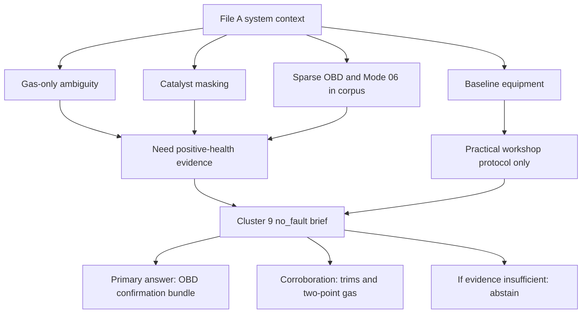

# Confirming No Fault Reliably for the 4DLab Cluster

## Executive summary

The attached context file describes 4DLab as a rule-based petrol-engine diagnostic system whose main limitation is not rule coverage but **measurement discrimination**: in many cases, the system only sees a warm-idle tailpipe 5-gas snapshot plus sparse diagnostics, and several fault families overlap in that evidence. For the specific `no_fault` cluster, the context is explicit that **catalyst masking** and **sensor under-detection** make a clean tailpipe alone insufficient to confirm a healthy vehicle. fileciteturn0file0 fileciteturn0file1

After reviewing the brief and cross-checking accessible official and technical sources, the strongest conclusion is that **no single practical scalar measurement** reliably confirms “no fault” on an OBD-II petrol vehicle. The **smallest practical discriminator** is instead a **structured OBD evidence bundle**: all supported readiness monitors complete, no stored/pending/permanent emission DTCs, no near-limit Mode $06 monitor results, and no sign that the OBD history was just cleared; fuel-trim stability and two-point gas stability are useful corroboration, but they are not sufficient on their own because a healthy catalyst can hide engine-out problems. This conclusion aligns with the context file’s warning about catalyst masking and with California BAR’s OBD pass/fail framework, which relies on readiness, MIL behavior, communication, and permanent DTC handling rather than tailpipe cleanliness alone. fileciteturn0file0 citeturn45view0turn22view2

The practical recommendation is therefore to **keep** OBD readiness, DTC status, Mode $06, sensor-response evidence, fuel trims, and two-point gas, but to **restructure them into a decision rule with abstention**. In engineering terms, the best additional “measurement” is not another hardware sensor; it is a **minimum OBD confirmation set** that the current baseline partly supports already, plus explicit support for **Mode $0A** permanent DTCs and ideally **Service $09 in-use performance tracking**. If that bundle is unavailable, incomplete, freshly reset, or near thresholds, the system should return **abstain** rather than `no_fault`. fileciteturn0file0 fileciteturn0file1 citeturn22view2turn39search0

The most important conflict between the files and the web evidence is not a factual contradiction, but a **goal mismatch**. Regulatory inspection programs are designed to determine whether a vehicle may **pass inspection** under a jurisdiction-specific rule set, and BAR explicitly allows some incomplete monitors on gasoline vehicles depending on model year. By contrast, the cluster brief asks for a **reliable engineering “no_fault” confirmation** that minimizes false-healthy calls. For that engineering goal, the evidence threshold should be **stricter than a jurisdictional pass threshold**: a car that is legal to pass with one incomplete monitor is not necessarily one that should be positively labeled healthy by 4DLab. fileciteturn0file1 citeturn45view0

Confidence in the **overall decision architecture** is **moderate-high**. Confidence is **high** for the importance of readiness, DTC status, MIL behavior, and recent-clear detection because those are clearly documented in official sources. Confidence is only **moderate** for universal quantitative thresholds on fuel trims, raw oxygen-sensor switching times, and elevated-RPM 5-gas bands, because those are much more OEM-specific or thinly documented in accessible public primary sources. citeturn45view0turn31search2turn39search0

## What the files say

### Key points from file A

File A frames 4DLab as a transparent, modular diagnostic engine for petrol spark-ignition vehicles. Its key channels are GASLab, OBDLab, DTCLab, and vehicle-identity/symptom channels. The dominant real-world input is often just **a single warm-idle 5-gas sample plus whatever DTCs happen to be present**, with live trims, freeze-frame, and Mode $06 frequently missing. The file states that several clusters are blocked by **missing separating information**, not by software defects. fileciteturn0file0

For this cluster specifically, the most relevant facts in file A are these: a clean tailpipe can be misleading because of **catalyst masking**; O2-sensor bias needs trim corroboration; gas-only evidence must never claim certainty; and the system is already converging on **two-point idle-to-RPM evidence** as a promising discriminator for some clusters, while acknowledging that some families should still **abstain rather than guess** if the available evidence is inherently uninformative. File A also defines the baseline equipment: a 5-gas analyzer and a generic OBD-II scan tool with Mode $01, $02, $03/$07, and $06 capability. fileciteturn0file0

### Questions extracted verbatim from file B

The specific research questions in file B are:

1. “**Discriminating measurement** — the single measurement, or smallest combination, that most reliably separates this cluster. Rank candidates by discriminating power × practicality.” fileciteturn0file1

2. “**Physical rationale** — the combustion / sensor / measurement mechanism that makes it separate.” fileciteturn0file1

3. “**Acquisition protocol** — exact procedure and equipment: test maneuver, RPM/load points, engine/warm-up state, sampling, number of points, and any architecture pre-gate required.” fileciteturn0file1

4. “**Expected signature** — the quantitative separator: direction, approximate magnitude, and a usable threshold or decision band, with numeric ranges where the literature supports them. State uncertainty and the conditions under which it fails.” fileciteturn0file1

5. “**Feasibility tier** — classify the equipment as (a) generic OBD-II live data / Mode $06, (b) the existing 5-gas analyzer used differently (e.g. transient or two-point capture, second probe), (c) added shop equipment (pressure transducer, scope, leak/compression tester), or (d) lab-only / impractical. Flag anything not obtainable in a normal workshop.” fileciteturn0file1

6. “**Evidence** — cite authoritative sources and note each source’s reliability.” fileciteturn0file1

### Relationship between the context and the cluster brief

The brief is tightly coupled to the context: file A defines **why** `no_fault` is hard to call, and file B asks for the **minimum evidence set** that overcomes that limitation without over-calling faults.

This mapping is explicit in the files themselves: the context says gas-only evidence cannot exonerate a catalyst-masked engine, and the cluster brief asks for a decision rule that calls `no_fault` only when the evidence is truly sufficient. fileciteturn0file0 fileciteturn0file1

## Mapping the questions to file A and to external research needs

| Question from file B | Facts from file A that matter | External information required | Sources used | Confidence |
|---|---|---|---|---|
| Discriminating measurement | Catalyst masking means clean tailpipe alone cannot prove health; OBD/Mode $06 are part of the system; gas-only certainty is capped. fileciteturn0file0 | OBD readiness rules; pending/permanent DTC handling; Mode $06 role; whether fuel trims and gas add incremental discrimination; jurisdiction-specific vs engineering thresholds. Jurisdiction unspecified. | BAR OBD Test Reference; secondary J1979/OBD service summaries. citeturn45view0turn22view2turn28search1turn39search0 | Moderate-high |
| Physical rationale | Context identifies catalyst masking, sensor bias, and overlap in gas-only signatures. fileciteturn0file0 | Mechanistic reason readiness, DTCs, and sensor monitors catch faults hidden by catalyst; meaning of pending/permanent codes; meaning of Mode $06 and sensor response data. | BAR; secondary OBD mode/PID summaries; peer-reviewed I/M limitation paper. citeturn45view0turn31search2turn39search0turn44academia6 | Moderate |
| Acquisition protocol | Baseline equipment is 5-gas + generic OBD-II; two-point idle→2500 RPM idea exists; architecture gating matters. fileciteturn0file0 | Exact OBD services/PIDs to read; MIL/communication prerequisites; whether Mode $0A and $09 are needed though not explicit in baseline; warm-state and recent-clear rules. Some details unspecified. | BAR; secondary PID/service summaries. citeturn45view0turn28search0turn39search0 | Moderate |
| Expected signature | Context gives warm-idle 5-gas norms and warns that two-point deltas can help in some clusters. fileciteturn0file0 | Numeric thresholds for readiness, DTC absence, sensor-response limits, trim bands, recent-clear floor, and 2500-rpm gas stability. Many are OEM- or jurisdiction-specific; some are unspecified in accessible literature. | BAR for readiness/PDTC floors; secondary PID definitions; context file for idle gas norms. citeturn45view0turn28search0turn31search2 fileciteturn0file0 | Moderate for OBD, low-moderate for universal trim/gas numbers |
| Feasibility tier | File A sets the workshop baseline and asks to justify anything beyond it. fileciteturn0file0 | Which items are available on baseline OBD and gas tools; whether added tools are really needed; whether some data are tool-support dependent. | BAR; secondary OBD service summaries. citeturn45view0turn39search0turn28search0 | High |
| Evidence | Brief wants authoritative sources and reliability notes. fileciteturn0file1 | Source hierarchy and explicit limitations where standards are paywalled or OEM-specific. | BAR; secondary standards summaries; peer-reviewed paper. citeturn45view0turn23search0turn44academia6 | High |

The biggest unspecified items are: **jurisdiction**, **vehicle model year scope beyond OBD-II-era petrol**, **exact OEM architecture**, **what “within band” means for trims**, **what counts as adequate Mode $06 headroom**, and **whether the “generic OBD-II scan tool” really supports Mode $0A and Service $09**. Those gaps materially affect how confident a `no_fault` call can be. fileciteturn0file0 fileciteturn0file1

## Integrated answers to the six research questions

### Discriminating measurement

The best practical answer is **not** a single additional sensor. It is a **minimum OBD confirmation bundle**, ranked first because it directly addresses exactly the false-healthy paths named in the files: catalyst masking, intermittent pending faults, and lazy-sensor under-detection. In order of discriminating power × practicality, the ranking is:

1. **OBD confirmation bundle — kept, but tightened into a single mandatory gate.**  
   Required elements: supported readiness complete; no stored DTCs; no pending DTCs; no permanent DTCs where supported; no near-fail Mode $06 results; and evidence that the OBD data were not just recently cleared. BAR’s inspection framework shows why these items matter operationally: readiness monitors verify emission-control functionality, MIL behavior and communication are part of the formal pass structure, and permanent DTC handling exists precisely because ordinary clearing can otherwise hide prior faults. citeturn45view0turn22view2  
   **Why kept:** this is the only candidate that directly targets hidden or intermittent failures behind a clean catalyst.  
   **Confidence:** High.

2. **Fuel trims at idle and 2500 RPM — kept, but only as corroboration.**  
   STFT/LTFT are standardized live-data items in Mode $01 and directly expose whether the controller is compensating for an unmetered-air, fuel-delivery, or sensor-bias problem. However, trim normality does not guarantee that all relevant monitors have run, and a narrow operating window can still miss intermittent faults. citeturn28search0turn31search0  
   **Why kept:** very practical and directly relevant to fuel-control health.  
   **Why not first:** it does not replace readiness, codes, or monitor evidence.  
   **Confidence:** Moderate.

3. **Mode $06 / oxygen-sensor monitor / catalyst monitor “margin,” not just pass/fail — kept.**  
   Mode $06 exists specifically to expose monitor test results beyond simple code presence, and oxygen-sensor monitor services can expose switch-time and threshold data. For this cluster, that matters because a system can be code-free yet still be operating close to a failure boundary. citeturn44search0turn31search2  
   **Why kept:** strongest way to detect “almost-failing” sensor/catalyst behavior without adding hardware.  
   **Limitation:** public universal thresholds are weak; interpretation is often OEM-specific.  
   **Confidence:** Moderate.

4. **Two-point gas stability at idle → 2500 RPM — kept, but demoted to corroboration.**  
   File A’s context points toward RPM-step evidence as valuable in several clusters, and two-speed practice is operationally attractive. But for `no_fault`, the core problem is that **a healthy catalyst can make tailpipe gas look normal even when the engine or sensor system is not fully healthy**. So two-point gas is useful as an additional “nothing looks wrong here” result, but not as the primary separator. fileciteturn0file0  
   **Why kept:** easy and already within baseline equipment.  
   **Why demoted:** catalyst masking makes it fundamentally non-exonerating.  
   **Confidence:** Moderate.

5. **Raw universal O2 switch-rate folklore — replaced.**  
   Publicly accessible sources confirm that OBD services can expose O2 switching-related metrics, but they do **not** support one universal cross-OEM milliseconds cutoff for a reliable healthy/no-fault decision. The better implementation is to use the vehicle’s **own monitor result and limit** where available, not a shop-folklore switching rule. citeturn31search2turn44search0  
   **Why replaced:** the data type is useful, but the universal hard threshold is not well standardized publicly.  
   **Confidence:** Moderate.

6. **Clean warm-idle 5-gas alone — rejected.**  
   Both the context file and the cluster brief explicitly reject this as sufficient evidence of health because of catalyst masking and hidden/intermittent sensor/control problems. fileciteturn0file0 fileciteturn0file1  
   **Confidence:** High.

**Bottom line for question 1:** the smallest practical discriminator is an **OBD health-confirmation bundle**, not a single new sensor. If that bundle is unavailable or incomplete, the system should not call `no_fault`; it should **abstain**. citeturn45view0turn22view2turn39search0

### Physical rationale

The physics and measurement rationale are straightforward once catalyst masking is taken seriously. A three-way catalyst can strongly attenuate tailpipe HC/CO/NOx downstream, so a downstream 5-gas reading may remain clean even when the engine upstream is not being controlled correctly. That is exactly why OBD exists as a complementary layer: it checks whether the catalyst, oxygen sensor, fuel-control system, and related emission monitors have actually run and passed. The context file’s “cat masking” warning and BAR’s OBD framework point in the same direction. fileciteturn0file0 citeturn45view0

Readiness monitors matter because a “no code” state is weak evidence if the relevant monitors have **not yet had an opportunity to execute**. BAR explicitly states that readiness monitors are self-tests performed by the vehicle’s OBD system to verify emission-control functionality and that monitor completion depends on correct operating conditions and properly functioning components. In other words, incomplete readiness is not neutral; it means the vehicle has not yet finished proving itself. citeturn45view0

Pending and permanent DTCs matter for two different hidden-fault pathways. A **pending DTC** can represent a problem seen in the current or last driving cycle before it becomes a confirmed code, which is precisely the intermittent-fault scenario the cluster brief worries about. A **permanent DTC** exists because ordinary code clearing or battery disconnect should not erase the record of a prior confirmed emissions fault until the vehicle itself verifies the defect is gone. That is why BAR treats a present PDTC on supported vehicles as a failure condition unless enough warm-up cycles and mileage have accumulated since clearing. citeturn28search1turn22view2

Mode $06 and oxygen-sensor monitor data matter because they move the system from “pass/fail only” toward **margin-to-failure**. Public OBD summaries describe Mode $06 as returning monitor test results with current values and limits, and oxygen-sensor monitor services include switching-related times and thresholds. For this cluster, that is exactly the right data type: a sensor can still be functioning well enough not to trigger a code, yet be sufficiently slow or marginal to weaken the evidentiary confidence of a healthy call. citeturn44search0turn31search2

Fuel trims add an orthogonal check on **active closed-loop correction**. STFT and LTFT exist precisely to represent short- and long-horizon fueling correction. If a supposedly healthy engine needs sustained correction at idle or at 2500 RPM no-load, that is positive evidence against a clean `no_fault` call. But trims alone still do not prove that catalyst, O2 sensor response, EVAP, and other monitors have completed successfully. citeturn28search0turn31search0

### Acquisition protocol

The recommended acquisition protocol is a **two-stage confirmation protocol** with explicit abstention logic.

**Stage one is the OBD gate.** Use the scan tool to confirm OBD communication, then record at minimum:  
Mode $01 PID $00 and PID $01; Mode $03 stored DTCs; Mode $07 pending DTCs; Mode $06 monitor results; Mode $02 freeze-frame if any emissions DTC exists. If the tool supports them, also read Mode $0A permanent DTCs and Service $09 information relevant to calibration identity and in-use performance tracking. BAR specifically notes that required OBD data for inspection typically include Mode $01 PID $00 and PID $01, and PID $01 returns MIL status, DTC count, and monitor status. BAR also requires correct MIL prove-out behavior and communication as part of the OBD pass structure. citeturn45view0

**Stage two is the corroboration capture.** Once the engine is fully warm and in stable closed-loop operation, capture one stabilized data window at **curb idle** and one at **2500 RPM no-load**. At each point, record STFT and LTFT for each supported bank, commanded or measured lambda/AFR if available, and a simultaneous stabilized 5-gas sample. File A already frames warm idle and idle→2500 as the most relevant practical maneuver for this general research stream. fileciteturn0file0

The practical pre-gates are important. The protocol should only attempt a positive `no_fault` confirmation when all of the following are true: the vehicle is petrol spark-ignition, OBD communication is valid, the catalyst is present if originally equipped, the engine is fully warm, the control system is in normal closed-loop operation, and the scan tool can actually retrieve the supported readiness and DTC states. If Mode $0A permanent DTCs or Service $09 in-use performance data are not supported by the tool, that limitation should be carried into the confidence score. This matters because file A’s baseline explicit tool list includes Mode $01/$02/$03/$07/$06, but it does **not** explicitly promise Mode $0A or $09, even though the cluster brief requires permanent-DTC and stronger OBD confidence handling. fileciteturn0file0 fileciteturn0file1 citeturn39search0turn28search1

The “how recent” rule should be handled conservatively. Because BAR uses **15 warm-up cycles and 200 miles since last clear** as the point after which a persistent PDTC may be ignored in its program, a stricter engineering protocol should treat vehicles below that floor as **at risk of a fresh-reset blind spot** and therefore unsuitable for a high-confidence `no_fault` call. That is not a universal worldwide rule; it is a practical, official, and defensible anti-reset floor from a real inspection program. Jurisdiction is otherwise unspecified, so it should be treated as a conservative engineering minimum, not a universal law. citeturn22view2turn45view0

Where accessible literature is thin, the following are engineering recommendations rather than standardized mandates: use a short stabilization period before recording each idle and 2500-RPM point; prefer medians over instantaneous values; and if the result is near a decision boundary, repeat the two-point sequence once before deciding. Those procedural refinements are reasonable but not well standardized in the public sources I could access. Their role is to reduce noise, not to create discrimination that is not really there. fileciteturn0file1

### Expected signature

The expected signature for a defensible `no_fault` call is **concordant normality across OBD evidence first, gas/trim corroboration second**.

The strongest quantitative items with clear public support are these. For California gasoline inspection rules, BAR allows **any one** incomplete monitor on 1996–1999 gasoline vehicles and only **EVAP incomplete** on 2000+ gasoline vehicles. However, that is a legal pass rule, not an engineering healthy-call rule. For 4DLab’s `no_fault` confirmation, the better threshold is **all supported non-continuous monitors complete**; otherwise the system should abstain. That stricter threshold is an inference driven by the brief’s false-healthy objective. citeturn45view0

For recent-clear detection, BAR’s official PDTC handling gives the most usable public floor: **at least 15 warm-up cycles and at least 200 miles since the OBD information was last cleared** for supported vehicles. Below that, the protocol should treat the evidence as insufficiently mature for a confident healthy call. That threshold is **standardized in BAR-OIS**, but only as a California inspection rule; using it as a 4DLab abstention floor is an engineering inference. citeturn22view2

For DTC-state signatures, the rule is stronger and cleaner:  
**stored DTCs = 0**, **pending DTCs = 0**, **permanent DTCs = 0** when supported. BAR’s PDTC logic is explicit for model-year 2010+ vehicles that support PDTC, and the OBD service definitions confirm that pending DTCs exist precisely to expose emissions faults detected before they mature into a confirmed code. citeturn22view2turn28search1

For Mode $06 headroom, the public literature does **not** provide a universal cross-OEM numeric “healthy margin” threshold. The most defensible approach is to normalize the current value against the vehicle-reported pass limit and require that it not sit extremely close to the fail boundary. A workable engineering rule is to mark a monitor as **marginal** if it lies within the last 10–20% of its allowable pass band, and to abstain from `no_fault` if a catalyst, primary O2/A/F sensor, or major emissions monitor is marginal. This threshold is an **inference**, not a standardized one. The standardized part is the existence of current values and limits in OBD monitor data. citeturn44search0

For oxygen-sensor dynamics, the standardized takeaway is the **data type**, not one universal number. OBD monitor services expose rich-to-lean and lean-to-rich switch times and related thresholds, and those should be compared against the vehicle’s own monitor criteria where available. A universal milliseconds cutoff could not be validated reliably from accessible primary sources, so exact raw-switch-time thresholds remain **unspecified** at the cross-platform level. citeturn31search2turn44search0

For fuel trims, the OBD standard gives the units and sign convention, but not a universal “healthy” band. The best engineering use is therefore: treat trim values **near zero** at both idle and 2500 RPM as positive evidence, and sustained positive or negative correction as evidence against a clean healthy call. A reasonable, explicitly non-standardized working band is **STFT median within about ±5% at each point, LTFT within about ±5% preferred, and combined correction without a meaningful idle-to-2500 shift**. Because I could not verify a universal primary-source numeric threshold, these values should be labeled **manufacturer-typical / empirical**, not standardized. citeturn28search0turn31search0

For 5-gas stability, file A provides the warm-idle healthy context: HC roughly ≤35 ppm with ≤50 tolerable, CO roughly 0.1–0.45%, CO2 about 14.5–16.0%, O2 low single digits, and normal-combustion patterns across the five gases. Those are useful baseline expectations. But for the 2500-RPM no-load point, I could not find a universally usable public primary-source threshold set that is better than a “stays clean and stable / does not deteriorate materially” criterion. Accordingly, the elevated-point gas threshold remains **unspecified at a universal level** and should be treated as corroborative rather than decisive. fileciteturn0file0

### Feasibility tier

The best evidence set remains overwhelmingly in **tier (a)**, with a helpful secondary contribution from **tier (b)**.

**Tier (a): generic OBD-II live data / Mode $06 — primary recommendation.**  
This includes readiness status from Mode $01 PID $01, stored DTCs from Mode $03, pending DTCs from Mode $07, Mode $06 monitor results, and—if supported—permanent DTCs and in-use performance tracking. This is the highest-value, lowest-friction path because it directly addresses hidden and intermittent emission faults. Its only practical caveat is that not every generic tool exposes every useful service cleanly, especially Mode $0A and Service $09 details. citeturn45view0turn39search0

**Tier (b): existing 5-gas analyzer used differently — recommended corroboration.**  
Using the existing analyzer for a second stabilized point at 2500 RPM no-load is practical and fits the research direction already suggested in file A. It is worth keeping because it provides extra confidence on combustion stability and because it helps in sparse-OBD or borderline cases. But it should not be promoted above the OBD gate for this cluster. fileciteturn0file0

**Tier (c): added shop equipment — not required for the default healthy call.**  
Smoke machine, scope, compression/leak-down tools, or pressure transducers may be useful to resolve **abstentions** or investigate suspected hidden faults, but they are not part of the smallest practical “confirm health” bundle. They should be triggered by a failure or abstention pathway, not used as first-line confirmation equipment for every candidate healthy vehicle. fileciteturn0file0

**Tier (d): lab-only / impractical — out of scope for routine confirmation.**  
A second probe upstream of the catalyst, a dynamometer transient cycle, or lab-grade emissions instrumentation would absolutely improve separability in principle, but the brief explicitly prioritizes workshop practicality. For this cluster, those methods are informative but not proportionate to the routine acquisition target. fileciteturn0file1

### Evidence and source reliability

The strongest source in this research set is the **California BAR On-Board Diagnostic Test Reference**, which is current through 2026 revisions and clearly documents readiness rules, MIL behavior, OBD communication requirements, and permanent DTC handling. It is **official and high reliability**, but it is also **California-specific**, so its thresholds should not be silently generalized as universal law. citeturn45view0turn22view2

The next most useful sources are public summaries of **SAE J1979 / OBD service and PID structure**. These are **secondary sources**, not the standards text itself, but they are useful for confirming the existence and meaning of: STFT/LTFT PIDs, pending DTCs, oxygen-sensor monitor switch-time data, Mode $06 monitor-result structure, and Service $09 in-use performance tracking. Reliability is **moderate**, and these sources are best used for service definitions rather than for high-stakes threshold setting. citeturn28search0turn28search1turn31search2turn39search0

The attached context and brief are obviously not external standards, but for **problem framing** they are the authoritative sources in this task: they define the failure mode 4DLab is trying to avoid and the exact operational question to answer. Reliability for system framing is **high**, but they are not substitutes for external threshold authority. fileciteturn0file0 fileciteturn0file1

A peer-reviewed paper on modern inspection/maintenance limitations was useful as background evidence that formal I/M procedures can still leave a gap to real-world vehicle condition. That evidence is **moderate reliability** for context, but it does not directly supply the threshold values needed for a workshop `no_fault` rule. citeturn44academia6

## Cross-reference, decision rule, and source summary table

### Cross-reference and verification

The web findings largely **confirm** file A rather than contradict it. File A says clean tailpipe gas can be misleading because of catalyst masking; BAR’s structure also treats OBD readiness, communication, MIL behavior, and permanent DTC handling as indispensable evidence on modern vehicles, which is consistent with the idea that clean gas alone is not enough. fileciteturn0file0 citeturn45view0turn22view2

The main **gap** is that file B asks for quantitative thresholds on fuel trims, sensor dynamics, and two-point gas stability “where literature supports them,” but accessible public primary sources do **not** provide a clean universal set of cross-OEM numbers for those signals. The public evidence is much stronger for **which data types matter** than for **one shared threshold** across all OBD-II petrol vehicles. That means the final protocol can be strong on decision architecture while remaining cautious on some numeric bands. fileciteturn0file1 citeturn31search2turn39search0

There is also a practical **baseline-tool conflict** between the files. File A’s baseline scan-tool list explicitly names Mode $01, $02, $03/$07, and $06, while file B expects permanent-DTC handling and stronger evidence of monitor execution. Permanent DTCs generally require **Mode $0A**, and the best “how recent” evidence is stronger if Service $09 in-use performance data are available. So, for this specific cluster, either the existing generic tool must already support those services, or the protocol must treat their absence as a confidence reduction or abstention trigger. fileciteturn0file0 fileciteturn0file1 citeturn22view2turn39search0

### Recommended decision rule

A `no_fault` call is justified only when **all** of the following are true:

- The vehicle is an OBD-II petrol vehicle and communicates normally over OBD.  
- The MIL proves out correctly: on KOEO, off KOER.  
- All supported **non-continuous** readiness monitors are complete.  
- Stored, pending, and permanent emission-related DTCs are all absent, to the extent the vehicle and tool support those services.  
- Mode $06 results for catalyst and primary oxygen/air-fuel monitoring are not merely passing, but not marginal.  
- The OBD record does not look freshly reset; practically, if the support exists, use warm-up cycles and distance since clear, with the BAR 15-warm-up / 200-mile rule as a minimum anti-reset floor.  
- STFT/LTFT are near zero and stable at both idle and 2500 RPM no-load.  
- Two-point 5-gas remains clean and stable and does not introduce contradictory evidence.  

If any required evidence is absent, incomplete, marginal, contradictory, or too recently cleared, the output should be **abstain: clean on available evidence, but evidence insufficient to confirm health**. That abstention rule follows directly from file A’s principle that a single evidence channel must not claim certainty where overlap exists. fileciteturn0file0 citeturn45view0turn22view2turn28search0turn39search0

### Question, required information, sources, and confidence

| Question | Required external information | Main sources used | Confidence |
|---|---|---|---|
| Discriminating measurement | Readiness, DTC lifecycle, PDTC behavior, monitor-result utility, tailpipe-vs-OBD complementarity | BAR OBD Test Reference; OBD service summaries | Moderate-high |
| Physical rationale | Why monitors and codes catch hidden faults; why gas alone can miss them | File A; BAR; OBD service summaries | Moderate |
| Acquisition protocol | Required OBD services/PIDs, MIL/comm rules, recent-clear handling, two-point procedure | BAR; OBD PID summaries; file A | Moderate |
| Expected signature | Readiness completion rules; PDTC anti-reset floor; DTC zero-state; monitor-margin concept; trim/gas cutoffs | BAR; OBD PID and monitor summaries; file A | Moderate overall |
| Feasibility tier | What baseline equipment can already capture; which capabilities may need a better tool | File A; BAR; OBD summaries | High |
| Evidence quality | Official vs secondary vs internal source hierarchy | BAR; secondary standards summaries; peer-reviewed background | High |

## Unresolved gaps and recommended next steps

The evidence is good enough to specify a **workable engineering protocol**, but several important gaps remain.

The first gap is **publicly accessible universal thresholds**. I could validate official, current rules for readiness, MIL behavior, communication, and California PDTC handling, but I could not validate one trustworthy cross-OEM universal threshold for:
- “healthy” STFT/LTFT bands,
- raw oxygen-sensor switch times in milliseconds,
- 2500-RPM no-load 5-gas pass bands,
- and Mode $06 “headroom” margins.  
These should therefore remain labeled **manufacturer-typical** or **engineering-inferred** rather than standardized. citeturn45view0turn31search2turn39search0

The second gap is **tool capability**. The baseline context does not explicitly guarantee Mode $0A permanent-DTC access or Service $09 in-use performance tracking. For this cluster, that matters. The next implementation step should be to audit the actual scan-tool fleet and answer, model by model, which of these are consistently retrievable:
- Mode $0A PDTCs,
- Service $09 PID $08 in-use performance tracking,
- oxygen-sensor monitor detail,
- calibration ID / CVN.  
If those are not reliably retrievable, the abstention rate for `no_fault` should be expected to rise. fileciteturn0file0 citeturn39search0turn22view2

The third gap is **real-vehicle empirical calibration** for the final decision band. A minimal collection plan would be:
- collect at least one balanced sample of known-good petrol OBD-II vehicles covering port injection, GDI, naturally aspirated, and turbocharged architectures;
- capture full OBD evidence at warm idle and 2500 RPM no-load, including readiness, DTC states, Mode $06, trims, and gas;
- repeat after known reset/clear events to quantify fresh-reset signatures;
- add a second cohort with known but catalyst-masked or intermittent faults;
- compute empirical distributions for trim stability, monitor margins, and two-point gas drift for healthy vehicles; then set abstention bands before fault bands.  
This directly answers the brief’s request for a practical discriminator without relying on folklore. fileciteturn0file1

The fourth gap is **jurisdictional portability**. BAR is an excellent official source, but it is California-specific. If 4DLab will operate outside a California/US OBD-II context, a follow-on pass should map the same protocol to:
- EOBD jurisdictional practice,
- local inspection/maintenance rules,
- and whatever scan-tool service availability is standard in the target market.  
At present, jurisdiction is unspecified, so the recommendation here should be treated as an **OBD-II-centric engineering protocol**, not a universal legal standard. citeturn45view0

The recommended next steps are therefore:

- **Adopt the OBD confirmation bundle as the primary `no_fault` gate.**
- **Add explicit abstention logic** whenever OBD evidence is incomplete, recently cleared, unsupported, or marginal.
- **Treat fuel trims and two-point gas as corroboration**, not exoneration.
- **Upgrade tool requirements** if necessary to include Mode $0A and ideally Service $09 in-use performance data.
- **Run a targeted healthy-vehicle data collection study** to convert the current moderate-confidence empirical bands into calibrated thresholds for 4DLab’s production decision rule.