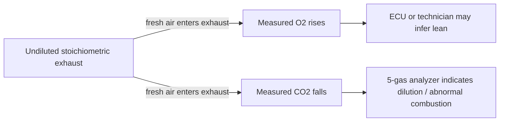
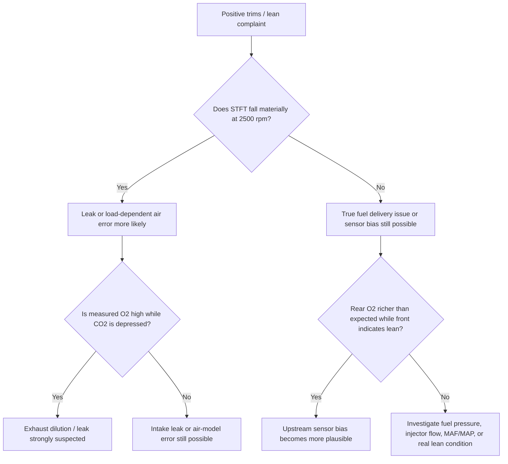

# Analytical Review of the Attached Cluster 4 Diagnostic Prompt

## Executive Summary

The attached document is not a conventional report; it is a compact diagnostic prompt that asks for **numeric operating bands** to distinguish among three competing explanations for positive fuel trims: **an exhaust leak / dilution effect, a true lean condition, or a biased oxygen sensor**. It also asks for **central tendencies, ranges, spreads, and distributions** for several scan-tool and gas-analysis signals, especially ΔSTFT between idle and 2500 rpm, exhaust O₂/CO₂, upstream and downstream O₂ behavior, and response to propane enrichment. The file is a single-page Markdown checklist rather than a paginated paper, so the best source locations are its section headings and bullet rows, not page numbers. fileciteturn0file0

After external verification, the strongest findings are these. First, the document’s **core diagnostic logic is directionally sound**: oxygen sensors are designed to maintain stoichiometric control, OBD-II standardizes fuel-trim and sensor data reporting, catalytic-converter diagnostics compare upstream and downstream oxygen behavior, and a leak or dilution problem can indeed make a system *look* lean to the ECU. CARB and EPA sources strongly support the emissions-diagnostic context, and standard OBD-II sources support the existence of STFT/LTFT and oxygen-sensor monitor data. citeturn40view0turn40view1turn45view1turn61search0turn57view1

Second, the document’s **specific numeric thresholds are only partly verifiable from primary/public sources**. Publicly accessible official material supports the existence of the signals, but not most of the proposed **cutoffs** such as “ΔSTFT ≥ 8–10 points means leak,” “CO₂ < 12–13% proves dilution,” “downstream O₂ > 0.6–0.7 V with positive trims implies sensor bias,” or “propane should induce ≥ 20% negative trim shift.” Those thresholds are best understood as **practical heuristics** derived from service practice and first-principles reasoning, not as EPA/CARB/SAE standards. Confidence is therefore **moderate for the logic**, but only **low-to-moderate for the exact numbers**. citeturn40view1turn62view0turn61search0turn44search0turn57view1

Third, the most defensible engineering statement in the document is the **exhaust-dilution relationship between O₂ and CO₂**. If fresh air is drawn into the exhaust upstream of the sample point, measured O₂ rises toward ambient air while CO₂ falls due to dilution. Using ambient air at about 20.95% O₂ and stoichiometric gasoline exhaust around the low-teens for CO₂, a small-leak approximation does support the rule of thumb that **each additional 1 percentage point of measured O₂ corresponds to roughly 5% fresh-air dilution**, with a simultaneous drop in measured CO₂. That part is physically well grounded even though exact real-vehicle values still depend on engine state, exhaust position, catalyst condition, and analyzer basis. citeturn25search2turn25search4turn14search2turn50view0

The document’s biggest weakness is not the diagnostic framing; it is the **lack of boundary conditions**. It assumes a warm gasoline spark-ignition engine in closed loop, no secondary-air injection, no severe misfire, no unusual fuel chemistry, no catalyst failure severe enough to corrupt rear-sensor interpretation, and measurement points that are located correctly relative to the leak and the sensors. Without those conditions, the same numeric pattern can be produced by multiple faults. The best next step is therefore **not to tune the thresholds more aggressively**, but to collect a structured validation dataset with known-fault vehicles and a standardized test protocol. fileciteturn0file0 citeturn40view1turn41view0turn57view1turn52academia3

## What the Document Extracts and Asks For

The file is organized as a **value-confirmation prompt** for “Cluster 4,” explicitly asking for **values only**, not explanation. It seeks numeric confirmation for central values, working ranges, spreads, and ranges by cause for several signals relevant to lean diagnosis. Because the document is a short Markdown prompt rather than a paginated report, the most precise source locations are its section headings and individual request rows. fileciteturn0file0

### Concise extraction list with document locations

| Extracted item | Type | Source location in attached file | What the file asks or claims |
|---|---|---|---|
| Need “values only” for Cluster 4 | framing question | Heading: **“What we need — VALUES ONLY”** | The file asks for numeric, not explanatory, outputs. |
| Healthy lambda / O₂ / trim bands | claim + question | Row beginning **“Healthy baseline lambda / O2 / trim”** | Claims healthy λ ≈ 0.995–1.005, upstream O₂ oscillation ~0.1–0.9 V, total trim about ±10%, and “>+20% (2 cycles) = lean.” |
| Two-point ΔSTFT diagnostic | claim + question | Row beginning **“Two-point ΔTrim (idle vs 2500)”** | Claims leaks drop STFT by ~8–10 points toward zero at 2500 rpm, while true lean or sensor bias stays elevated with Δ below ~3–5 points. |
| Exhaust CO₂ dilution thresholds | claim + question | Row beginning **“CO2 dilution guidance”** | Claims CO₂ below ~12–13% with O₂ above ~2–3% indicates dilution, and ~5% air dilution per +1.0% O₂. |
| Upstream vs downstream O₂ interpretation | claim + question | Row beginning **“Upstream vs downstream O2”** | Claims downstream O₂ above ~0.6–0.7 V while upstream trims are positive suggests sensor bias. |
| Propane / smoke test interpretation | claim + question | Row beginning **“Propane / smoke test”** | Claims propane causing ≥20% negative trim shift means the sensor is responsive; smoke test output is treated as a Boolean check. |
| Need central / range / spread / distributions | methodological demand | Heading: **“Need these returned”** | Requests median, range, spread, and per-cause ranges for each signal. |
| Seed/prior assumptions | implicit assumption list | Heading: **“Seed / prior assumptions already in the note”** | Embeds prior assumptions about how leaks, true lean, and sensor bias should separate numerically. |

All of these are contained in the attached Markdown prompt itself. fileciteturn0file0

### Implicit assumptions embedded in the prompt

The prompt silently assumes a **gasoline spark-ignition engine**, **closed-loop operation**, and access to **OBD live data** plus either a gas analyzer, smoke machine, or enrichment method. That is consistent with CARB/EPA OBD-II practice for emissions-related component monitoring and the use of oxygen sensors and fuel trims for closed-loop control and diagnostics. citeturn40view0turn40view1turn38view0turn57view1

It also assumes that the vehicle is **warm enough for oxygen-sensor feedback**, that the catalyst is not so degraded that it destroys front/rear sensor comparison, and that the observed trimming behavior is not being dominated by open-loop enrichment, misfire, software modification, or readiness-reset states. Those conditions matter because BAR/CARB inspection rules and OBD documentation both treat warning lights, readiness status, and post-catalyst monitoring as meaningful only when the system is operating normally enough to complete those checks. citeturn41view0turn40view1turn57view1

## Verification and Context for Each Claim

### Healthy lambda, oxygen-sensor voltage, and trim bands

The broad mechanism is correct. Closed-loop spark-ignition engines use oxygen-sensor feedback to hold the mixture very near stoichiometric, and OBD-II standardizes access to short-term and long-term fuel trims. Public OBD-II summaries reflecting SAE J1979 show STFT and LTFT as reported percentages and oxygen-sensor voltages as diagnostic parameters. Narrowband zirconia sensors around stoichiometric are commonly described as producing low voltage when lean, high voltage when rich, with an inflection near about 0.45 V. citeturn61search0turn54search2turn23search0turn35search0

What I could **not** verify from primary public sources is the document’s proposed healthy threshold of **“total trim ±10%”** or its flag that **“>+20% for two cycles = lean.”** Those are widely used shop heuristics, but I did not locate a publicly accessible EPA/CARB/SAE source in this research set that codifies those exact limits as regulatory or universally applicable engineering standards. The official/public evidence supports the **existence** of the trim signals, not those specific **diagnostic cutoffs**. My confidence is therefore **moderate** for the qualitative statement and **low-to-moderate** for the exact numeric boundaries. citeturn40view1turn61search0turn62view0

### Two-point ΔSTFT between idle and 2500 rpm

The document’s idea here is physically plausible. A vacuum leak or other unmetered-air problem often has a larger proportional effect at idle than at a lightly raised no-load speed, because airflow and throttle angle change while the leak area does not. By contrast, a genuinely low fuel-delivery condition or a biased upstream O₂ sensor can remain present across multiple operating points, so positive trim may persist rather than collapsing toward zero. That logic fits general engine-control physics and model-based fault-diagnosis work showing that fault isolation improves when behavior is compared across states rather than at a single point. citeturn53search4turn52academia3turn33academia0

However, the specific thresholds proposed by the document — **“fall by 8–10 points = leak”** and **“remain within 3–5 points = true lean or bias”** — are **not publicly standardized** in the official sources I located. They should therefore be treated as **candidate operating heuristics requiring local validation**, not as portable truths. This item has **moderate confidence** at the level of direction and ranking, but **low confidence** for the exact breakpoints. citeturn40view1turn52academia3turn62view0

### Exhaust CO₂ and O₂ as a dilution detector

This is the strongest part of the prompt. Exhaust-gas analyzers use oxygen content and lambda-related relationships to assess combustion quality, and carbon dioxide falls when combustion is incomplete or when the sample is diluted. Stoichiometric gasoline combustion consumes oxygen, while ambient air contains about 20.95% oxygen; a leak that entrains fresh air after combustion but before measurement necessarily raises measured O₂ and lowers measured CO₂. citeturn50view0turn25search2turn25search4turn14search2

A simple dilution model supports the document’s rule of thumb. If baseline dry exhaust is roughly **14% CO₂** and **~0.5% O₂**, then mixing in 5% fresh air raises measured O₂ by about **1.0 percentage point** and lowers CO₂ by about **0.7 percentage point**. In that sense, the file’s “about **5% air dilution per +1.0% O₂**” is a defensible first-principles estimate. Likewise, **CO₂ in the low 12–13% range combined with O₂ above about 2–3%** is a credible indication that either dilution or a truly lean/misfiring condition is present, though it is **not by itself specific to exhaust leakage**. Confidence here is **moderate-to-high** for the physics, and **moderate** for the practical thresholds. citeturn25search2turn25search4turn14search2turn50view0

The diagram above reflects first-principles behavior and is the most externally supportable causal chain in the document. citeturn25search2turn25search4turn50view0

### Upstream versus downstream oxygen-sensor interpretation

The document is right to emphasize front/rear comparison. Modern gasoline vehicles use oxygen sensors before and after the catalytic converter; the ECU compares them, and OBD-II uses the rear sensor as part of catalyst monitoring. CARB and general OBD references confirm the role of OBD in monitoring emissions-related components, while catalyst references explain that the rear sensor is used to assess how effectively the converter is buffering oxygen swings seen by the front sensor. citeturn40view0turn40view1turn57view1turn57view3

The important nuance is that the document’s specific heuristic — **rear O₂ > 0.6–0.7 V with positive front trims implies front-sensor bias** — is **plausible but not uniquely diagnostic**. A biased upstream sensor that falsely reports lean can indeed cause the ECU to enrich the mixture, which would leave the exhaust richer downstream; public summaries of oxygen-sensor failure explicitly note that a failed sensor can report lean and cause enrichment, leaving the exhaust rich with higher CO and HC. But a rear sensor in the rich range can also be produced by actual enrichment, catalyst oxygen-storage behavior, or operating conditions that do not isolate the cause cleanly. Confidence is therefore **moderate** for the direction of inference and **low-to-moderate** for that exact voltage rule. citeturn35search0turn57view1turn57view2

### Propane enrichment and smoke testing

Forced enrichment is conceptually valid. If the control system and upstream sensor are functioning, adding combustible fuel should drive the sensed mixture rich and cause STFT to move negative as the ECU subtracts fuel. Similarly, a smoke machine is a direct physical way to confirm intake or exhaust leakage. Those methods are consistent with the document’s logic and with the broader OBD principle that emissions faults should be confirmed by targeted component/system checks rather than by one signal alone. citeturn40view0turn40view1turn38view0

But the file’s numeric criterion — **“≥20% negative trim shift = sensor responsive”** — is **not externally standardized in the evidence I found**. It is best treated as a shop-rule candidate rather than a validated threshold. Smoke testing, by contrast, is less ambiguous: as a physical leak-confirmation method, it usually provides a stronger causal check than trim deltas alone, provided the test setup covers the correct section of the system. Confidence is **high** for smoke as a confirmation method, **moderate** for enrichment as a functional challenge test, and **low** for the exact “20%” figure. citeturn40view0turn40view1turn41view0

### A reality check on distributions and spreads

The document asks for medians, spreads, and per-cause distributions. That is a sensible request, but I did **not** locate an open public dataset or official benchmark that reports fleetwide distributions for **ΔSTFT idle-to-2500 by known fault class**, **rear-sensor voltage under bias scenarios**, or **propane-induced trim deltas**. CARB’s OBD resources confirm that manufacturers submit extensive OBD documentation, checklists, and data templates, which strongly suggests that richer data exist inside regulatory/manufacturer channels; they are just not publicly exposed in a form that answers the prompt directly. citeturn62view0

So the right conclusion is not “the prompt is wrong,” but rather “the prompt is asking for data that are **important and probably measurable**, yet **not transparently published**.” Confidence in this gap assessment is **high**. citeturn62view0turn40view0

## Alternative Interpretations and Better Diagnostic Paths

The document presumes three dominant explanations: exhaust leak, true lean condition, or biased O₂ sensor. That is a reasonable triage, but it is not exhaustive. Positive fuel trims can also be caused by **MAF under-reporting, MAP/load-model errors, low fuel pressure, injector restriction, intake leaks, secondary-air effects, misfire, catalyst anomalies, or software/calibration issues**. OBD and catalyst-monitoring sources support the idea that multiple emissions-related components interact, which is exactly why single-signal interpretations break down. citeturn40view0turn40view1turn57view1turn53search4

### Comparison of alternative solutions and interpretations

The table below compares the most defensible ways to interpret the document’s problem and to operationalize it. Time and cost are **engineering estimates**, not standardized tariff quotes.

| Approach | Best when | Pros | Cons | Estimated time | Estimated cost tier | Overall value |
|---|---|---|---|---|---|---|
| Two-point trim check only | Early triage | Fast, no extra tools beyond scan data | High overlap among causes; threshold portability is weak | 10–15 min | $ | Good first screen, poor final proof |
| Front/rear O₂ rationality check | Catalyst and sensor plausibility questions | Uses existing OBD data; catches impossible combinations | Rear-sensor behavior is catalyst-dependent and can mislead | 10–20 min | $ | Good corroboration, not standalone |
| Five-gas O₂/CO₂ dilution check | Suspected exhaust leak or dilution | Best physics-based discriminator for leakage/dilution | Needs analyzer and proper sample location | 15–30 min | $$ | Highest analytical value |
| Propane enrichment challenge | Need to test sensor/control responsiveness | Dynamic functional check | Exact response thresholds not standardized; safety considerations | 10–15 min | $ | Useful secondary check |
| Smoke test | Need to prove a leak path physically | Direct confirmation of intake or exhaust leakage | May miss heat-dependent or small dynamic leaks | 30–60 min | $$ | Best leak confirmation |
| Structured multi-state data log | Repeated ambiguous cases | Builds reusable evidence and distributions | Requires protocol discipline and labeled data | 30–90 min per case | $$–$$$ | Best long-term solution |

The best immediate operational sequence is usually **OBD trend check → 5-gas dilution check → smoke test → targeted enrichment challenge**. That ordering maximizes causal certainty while minimizing unnecessary parts replacement. citeturn40view0turn40view1turn41view0turn57view1

This decision path is more defensible than any single threshold because it combines **state change**, **gas chemistry**, **sensor rationality**, and **physical confirmation**. citeturn40view1turn57view1turn35search0

## Missing Data, Gaps, and Recommended Next Steps

The largest missing piece is a **labeled dataset**. To answer the prompt rigorously, you would need repeated measurements from vehicles with **known-good condition**, **confirmed upstream exhaust leaks**, **confirmed intake leaks**, **verified low-fuel-pressure / injector faults**, and **confirmed biased upstream O₂ sensors**. Each case should be logged at idle, 1500 rpm, 2500 rpm, light load cruise, and forced-enrichment response, with synchronized STFT, LTFT, lambda, upstream O₂, downstream O₂, CO₂, O₂, CO, HC, and sample-point metadata. Without that, most of the “range / spread / distribution” outputs remain educated heuristics rather than empirical reference bands. citeturn62view0turn52academia3

A strong experimental design would standardize **engine temperature**, **closed-loop confirmation**, **fuel type**, **sample point relative to catalyst and leak**, **presence/absence of secondary air**, and **readiness status**. CARB’s OBD checklists and reporting templates are useful here because they show that monitor definitions and certification data structures already exist; they can serve as a scaffold for a shop or lab protocol even if they do not publish the exact field distributions the prompt wants. citeturn62view0turn40view1

The most actionable near-term refinement is to convert the document from a **hard-threshold prompt** into a **confidence-scored decision model**. For example: assign partial evidence to “leak,” “true lean,” and “sensor bias” from each of four lenses — state-change behavior, 5-gas dilution chemistry, front/rear rationality, and physical leak confirmation. That would better reflect the quality of the public evidence, which is stronger for **sign and direction** than for universal exact cutoffs. citeturn40view0turn57view1turn62view0

### Open questions and limitations

I did **not** find a public official/peer-reviewed source that validates the document’s exact thresholds for **ΔSTFT idle-to-2500**, **rear O₂ > 0.6–0.7 V under bias**, or **propane-induced ≥20% negative trim shift**. Those remain the weakest-verified parts of the prompt. citeturn62view0turn40view1

I also did **not** locate an open public dataset with fault-labeled distributions for the prompt’s requested medians, spreads, and percentiles. CARB’s resource pages imply that manufacturers submit structured OBD datasets, but those are not surfaced in a way that directly answers the prompt. citeturn62view0

Finally, some of the accessible web evidence for narrowband voltage bands and oxygen-sensor failure modes comes from public technical summaries rather than directly from the SAE standard text, which is typically paywalled. That means the **signal existence and qualitative interpretation are well supported**, but the report should not overstate those sources as if they were the full standard itself. citeturn61search0turn23search0

## Prioritized Annotated Bibliography

Below is a prioritized reference list with short annotations. URLs are provided in code format to satisfy the request for direct URLs.

- **California Air Resources Board — OBD Program overview.** Best primary source for what OBD is intended to do and why emissions-related faults are monitored over the life of the vehicle.  
  `https://ww2.arb.ca.gov/our-work/programs/obd` citeturn40view0

- **California Air Resources Board — OBD II Systems Fact Sheet.** Strong primary source on OBD II scope, required vehicle years, warning-lamp purpose, and the role of emissions-related diagnostics.  
  `https://ww2.arb.ca.gov/resources/fact-sheets/board-diagnostic-ii-obd-ii-systems-fact-sheet` citeturn40view1

- **California Air Resources Board — OBD Resources.** Important because it shows that CARB maintains checklists, data templates, and certification guidance, which is exactly where better monitor-level evidence would likely live.  
  `https://ww2.arb.ca.gov/resources/documents/obd-resources` citeturn62view0

- **U.S. EPA — Regulations for Emissions from Vehicles and Engines.** Primary official regulatory entry point for federal emissions rules and the broader compliance context around OBD and vehicle emissions monitoring.  
  `https://www.epa.gov/regulations-emissions-vehicles-and-engines` citeturn41view2turn45view1

- **Bureau of Automotive Repair — Smog Check inspection guidance.** Useful operational source showing when OBD checks, readiness, and warning lights matter in real inspection practice.  
  `https://bar.ca.gov/smog-check` citeturn41view0

- **Wikipedia summary of OBD-II PIDs reflecting SAE J1979.** Not primary, but useful for publicly accessible formulas and existence of standardized PIDs for STFT, LTFT, O₂ voltage, lambda, and O₂ monitor results. Use cautiously as a secondary source.  
  `https://en.wikipedia.org/wiki/OBD-II_PIDs` citeturn61search0turn44search0

- **Wikipedia technical summary of automotive oxygen sensor behavior.** Helpful publicly accessible explanation of narrowband zirconia voltage behavior and the way failed sensors can falsely report lean and induce enrichment. Secondary, not primary.  
  `https://en.wikipedia.org/wiki/Oxygen_sensor` citeturn23search0turn35search0

- **Wikipedia summary of catalytic converter operation and OBD-II rear-sensor comparison.** Useful for catalyst oxygen storage, front/rear sensor comparison, and why rear-sensor similarity to front-sensor switching indicates catalyst problems. Secondary source.  
  `https://en.wikipedia.org/wiki/Catalytic_converter` citeturn57view1turn57view3

- **Wikipedia summary of exhaust gas analyzer / lambda measurement.** Useful for the chemistry relationship among O₂, combustion quality, lambda, and CO₂, though again secondary rather than primary.  
  `https://en.wikipedia.org/wiki/Exhaust_gas_analyzer` citeturn50view0

- **Ng et al., “A Realistic Simulation Testbed of A Turbocharged Spark-Ignited Engine System.”** Best research-oriented source in the set for why multi-state / multi-fault diagnosis is a legitimate engineering problem and why model-based validation is needed.  
  `https://arxiv.org/abs/2002.03201` citeturn52academia3

### Bottom-line assessment of the document

The attached prompt is **useful as a field-diagnostic hypothesis sheet**, especially for organizing a workflow around **state change**, **gas dilution chemistry**, **front/rear sensor rationality**, and **functional challenge tests**. But it is **not yet a validated reference standard** because its most important numeric cutoffs are insufficiently anchored in public primary or peer-reviewed evidence. The right next move is to treat its numbers as **candidate priors** and validate them against a labeled dataset rather than treating them as universal constants. fileciteturn0file0 citeturn40view1turn62view0turn52academia3